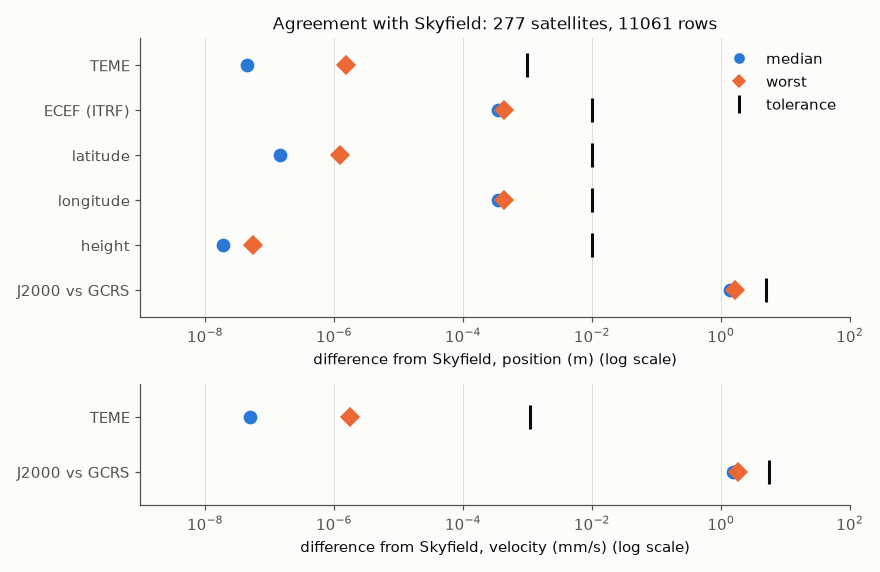
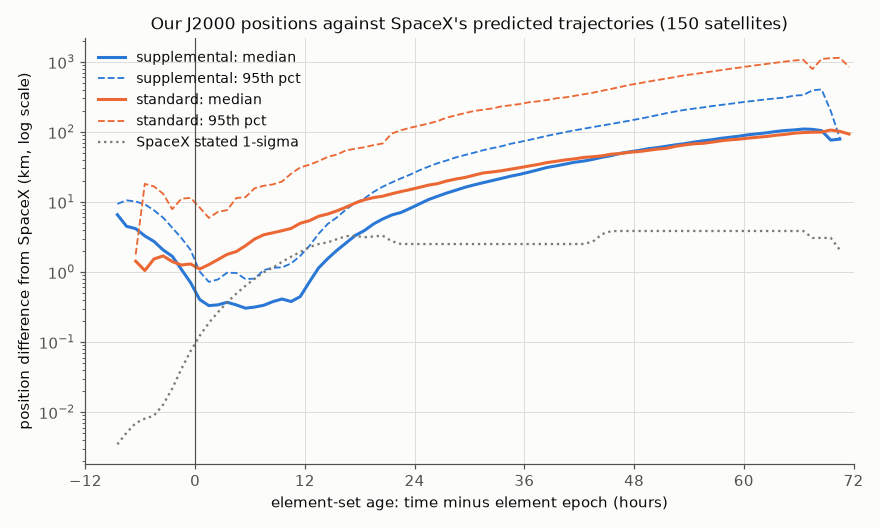
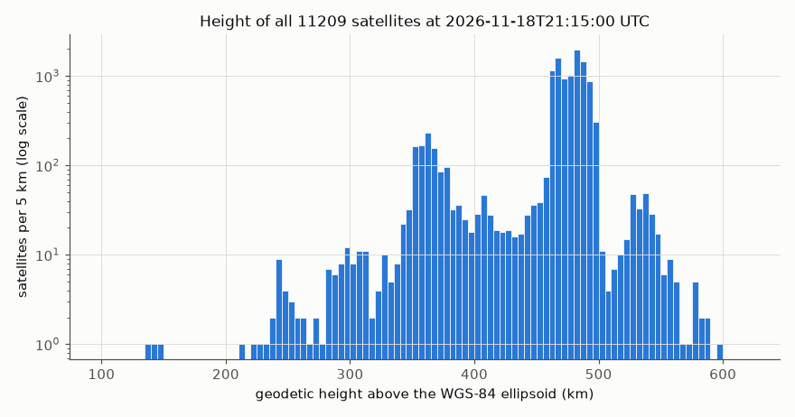
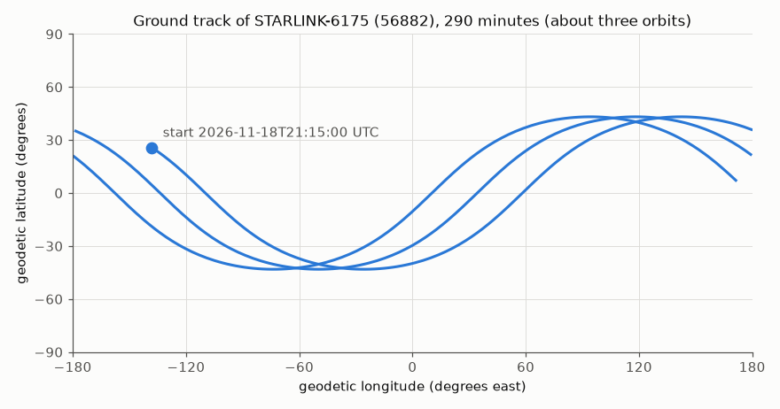

# Phase 1 results: orbits

This report says what Phase 1 built, how it was checked, and how close its positions are to
independent references and to SpaceX's own predictions. It uses the terms defined in the
glossary of [the Phase 1 spec](phase-1-orbits.md#2-background-the-terms-this-spec-uses).
All numbers come from the snapshot `data/starlink/2026-11-18/`, downloaded on 2026-11-18
around 21:05 UTC. The section [Reproducing every number](#reproducing-every-number) gives the
commands.

## What was built

- **A snapshot.** One download of the standard and supplemental Starlink element sets from
  CelesTrak (OMM JSON), the IERS Earth-orientation file `finals2000A.all`, and SpaceX's
  trajectory files for 150 satellites. The first three are in git. The trajectory files are
  not (about 300 MB, and the site states no redistribution terms); `metadata.json` records
  the sha256 of each one.
- **A C++ library**, in four modules:
  - `time`: a UTC instant held as whole days plus a fraction, never one floating-point
    number; Greenwich Mean Sidereal Time (GMST, IAU 1982); UT1 and TT from UTC; the
    Earth-orientation table read from the IERS file and interpolated linearly between days.
  - `orbit`: the OMM JSON loader; the choice of one element set per satellite
    (supplemental where it exists, otherwise standard); Vallado's reference SGP4, vendored
    unmodified, behind a small interface.
  - `frames`: TEME to Earth-fixed ITRF (GMST at UT1, then polar motion); TEME to J2000
    through the classical IAU-76/FK5 precession and nutation; Earth-fixed to WGS-84
    latitude, longitude and height.
  - `core`: angle conversions.
- **The `propagate` program.** Snapshot, start time, duration and step in; one CSV row per
  satellite per time out, with TEME position and velocity, ITRF position, latitude,
  longitude and height, J2000 position and velocity, the element source and the element
  age. It prints a summary: satellites loaded and failed, element ages, heights.
- **Three Python scripts**: `validate_against_reference.py` (against Skyfield, run in CI),
  `compare_spacex.py` (against SpaceX's trajectories, run by hand) and `plot_phase1.py` (the
  plots below), with shared helpers in `snapshot_tools.py`.

## Three layers of proof

Each layer checks a different part, against a reference that does not share our code for
that part.

### 1. The propagator against the published SGP4 cases

Vallado's SGP4 comes with a file of test element sets and the positions his code printed
for them. `tests/orbit/sgp4_verification_test.cpp` runs all 33 satellites of that file
through our wrapper and compares every printed position. The worst difference is
1.15e-7 km (0.1 mm), which is the rounding of the printed values. This shows that our
inputs to SGP4 (units, epoch, gravity model) are the ones the published code expects.

### 2. Time and frames against printed examples and ERFA

- **Vallado's printed frame example** (AIAA 2006-6753, Appendix C). Our ITRF position is
  13 mm from his. His code holds the Julian date in one floating-point number, which limits
  his printed values to about 25 mm, so the 13 mm is his rounding, not ours. Our J2000
  position is 0.47 mm from his when we use the 4-term nutation his paper used, and 1.14 m
  when we use the full 106-term series, which is what the program uses.
- **ERFA**, the open-source copy of the IAU's standard routines, has its own
  implementations of GMST, polar motion, IAU 1976 precession and IAU 1980 nutation.
  `python/gen_frame_reference.py` computes reference values with it, and the unit tests
  require agreement to within 1e-14 rad for angles, 1e-10 rad for GMST and 1 um for
  rotated positions. Each tolerance is at least 100 times the largest difference seen.

### 3. The whole program against Skyfield (the `validate` CI step)

[Skyfield](https://github.com/skyfielders/python-skyfield) 1.55 uses the same Vallado SGP4
(through python-sgp4 2.27), but its time scales, Earth rotation, polar motion and frame
code are its own. `python/validate_against_reference.py` runs `propagate` on a fixed sample
and recomputes every row with Skyfield, from the same element set and the same
`finals2000A.all`.

The sample: 277 satellites (240 spread evenly through the catalogue numbers, 12 more with
six-digit numbers, the 15 lowest and 5 highest orbits, the 5 most eccentric) at 40 times,
every 2 h 0 min 13.75 s from 2026-11-18 13:15 UTC to 2026-11-21 19:24 UTC. The first times
lie before most element epochs (all epochs are between 2026-11-16 19:30 and 2026-11-18
19:19), so negative element ages are covered. That is 11,061 rows. One satellite,
STARLINK-1423 (45710), is re-entering: it is at 87 km on 2026-11-20 05:20 UTC, and its 19
later times fail in both SGP4 runs. The check requires that a row exists exactly when
Skyfield's SGP4 succeeds.

| Quantity | Median | Worst | Tolerance | Why this tolerance |
|---|---|---|---|---|
| TEME position | 4.5e-8 m | 1.5e-6 m | 1 mm | Same SGP4 code and inputs; fixed by the spec |
| TEME velocity | 5.0e-8 mm/s | 1.8e-6 mm/s | 1.1e-3 mm/s | Position tolerance times the orbital rate (1.1e-3 per second) |
| ITRF position | 0.35 mm | 0.43 mm | 1 cm | Same model, different route; fixed by the spec |
| Latitude | 1.4e-7 m | 1.3e-6 m | 1 cm | Inherits the ITRF difference |
| Longitude | 0.35 mm | 0.43 mm | 1 cm | Inherits the ITRF difference |
| Height | 1.9e-8 m | 5.6e-8 m | 1 cm | Inherits the ITRF difference |
| J2000 against GCRS, position | 1.39 m | 1.63 m | 5 m | Different models by design; fixed by the spec |
| J2000 against GCRS, velocity | 1.56 mm/s | 1.85 mm/s | 5.5 mm/s | Position tolerance times the orbital rate |
| Element age | 0 s | 2.9e-11 s | 1 us | The epoch of the element set the rule picks |

Latitude and longitude differences are converted to metres on the ground. The latitude,
longitude and height reference is ERFA's exact conversion (`eraGc2gd`, WGS-84) of
Skyfield's ITRF position. Skyfield's own `wgs84.geographic_position_of` is also checked
against the same 1 cm: it agrees to 2.7 mm in latitude, because it stops its iteration after
three rounds. Every satellite also used the element source the documented rule picks.

What the measured values mean:

- **TEME: 1.5 um.** Both sides run the same SGP4; the micrometres come from computing the
  time since the epoch in a different order.
- **ITRF: 0.43 mm, all of it in longitude.** Skyfield applies one small rotation we leave
  out, the TIO locator s' (47 microarcseconds per century, 12.6 microarcseconds now). At a
  6900 km radius that is 0.42 mm.
- **J2000: 1.4 to 1.6 m.** This is a difference between models, not an error. Our J2000 is
  the classical FK5 frame (IAU 1976 precession, IAU 1980 nutation). Skyfield's GCRS uses
  the IAU 2006/2000A models and includes the 23-milliarcsecond frame bias between FK5 and
  GCRS (0.8 m at this radius).

The same check run on x86-64 (an amd64 container) gives the same values to two significant
digits (for example a worst TEME velocity difference of 1.74e-6 instead of 1.79e-6 mm/s), so
every tolerance holds on both architectures with a wide margin.



**The check fails on real errors.** Each of these was planted in the C++ code temporarily,
the program rebuilt and the check run:

| Planted error | What the check reported (worst row) |
|---|---|
| GMST rotation skipped | ITRF off by 13,700 km |
| Time shifted by 1 s | TEME, ITRF and J2000 off by 7.9 km |
| WGS-84 constants inside SGP4 | TEME off by 51 m (median) to 5.7 km |
| UT1 - UTC dropped | ITRF off by 32 m (median) to 40 m |
| Polar motion dropped | ITRF off by 9.8 m (median) to 11.8 m |
| Polar motion x sign flipped | ITRF off by 6.5 m (median) to 7.9 m |

Every one made the script exit with status 1 and name the satellite and time.

## How close to reality: SpaceX's trajectories

SpaceX publishes, for each Starlink satellite, its own predicted path for the next two or
three days at 60-second steps, in J2000, with a stated uncertainty at every step. These are
the operator's best forecast, not a measurement of where the satellite ended up.
`python/compare_spacex.py` compares our J2000 positions with all 150 trajectory files of the
snapshot at every step they cover (635,181 steps), twice: once with the supplemental
element sets and once with the standard ones (a copy of the snapshot whose `supgp.json` is
empty). The difference is split into radial (up and down), in-track (along the direction of
motion) and cross-track (sideways), using SpaceX's position and velocity to define the
directions. It is shown against element age: time minus the element set's epoch, negative
before the epoch.

SpaceX's stated uncertainty is the 1-sigma (one standard deviation) position uncertainty
from the covariance in each file, as the root sum of squares of its radial, in-track and
cross-track parts. It is shown next to our difference so that our model's error and the
forecast's own uncertainty are not confused.

**Supplemental element sets** (fitted by CelesTrak to SpaceX's trajectories). Distances in km.

| Age (h) | Steps | Median | 95th pct | Radial med | In-track med | Cross-track med | SpaceX 1-sigma (median) |
|---|---|---|---|---|---|---|---|
| -12 to -6 | 3,116 | 4.43 | 10.4 | 0.164 | 4.41 | 0.108 | 0.006 |
| -6 to -3 | 16,352 | 2.55 | 7.38 | 0.162 | 2.54 | 0.115 | 0.010 |
| -3 to -1 | 17,530 | 1.31 | 3.78 | 0.149 | 1.28 | 0.117 | 0.031 |
| -1 to -0.5 | 4,500 | 0.857 | 2.29 | 0.129 | 0.808 | 0.117 | 0.064 |
| **-0.5 to 0.5** | 9,000 | **0.469** | 1.47 | 0.123 | 0.405 | 0.119 | 0.097 |
| 0.5 to 1 | 4,500 | 0.390 | 0.884 | 0.097 | 0.292 | 0.116 | 0.136 |
| 1 to 3 | 18,000 | 0.335 | 0.751 | 0.089 | 0.249 | 0.108 | 0.225 |
| 3 to 6 | 27,000 | 0.337 | 0.930 | 0.058 | 0.274 | 0.107 | 0.492 |
| 6 to 12 | 54,000 | 0.371 | 1.22 | 0.074 | 0.314 | 0.113 | 1.26 |
| 12 to 24 | 108,000 | 2.98 | 15.3 | 0.162 | 2.97 | 0.141 | 2.67 |
| 24 to 36 | 108,000 | 15.6 | 53.3 | 0.250 | 15.6 | 0.136 | 2.50 |
| 36 to 48 | 106,130 | 36.6 | 118 | 0.303 | 36.6 | 0.205 | 2.50 |
| 48 to 72 | 159,053 | 77.3 | 263 | 0.444 | 77.3 | 0.284 | 3.84 |

**Standard element sets** (fitted by the US Space Force to radar tracking). Distances in km.

| Age (h) | Steps | Median | 95th pct | Radial med | In-track med | Cross-track med | SpaceX 1-sigma (median) |
|---|---|---|---|---|---|---|---|
| -12 to -6 | 73 | 1.22 | 1.77 | 0.223 | 1.16 | 0.146 | 0.006 |
| -6 to -3 | 647 | 1.58 | 16.5 | 0.318 | 1.50 | 0.146 | 0.006 |
| -3 to -1 | 3,363 | 1.30 | 8.12 | 0.209 | 1.13 | 0.144 | 0.007 |
| -1 to -0.5 | 1,620 | 1.27 | 15.6 | 0.185 | 1.19 | 0.126 | 0.008 |
| **-0.5 to 0.5** | 3,671 | **1.23** | 8.05 | 0.196 | 1.12 | 0.137 | 0.011 |
| 0.5 to 1 | 2,089 | 1.09 | 9.64 | 0.177 | 0.993 | 0.132 | 0.017 |
| 1 to 3 | 9,453 | 1.40 | 6.54 | 0.185 | 1.31 | 0.147 | 0.038 |
| 3 to 6 | 15,696 | 1.98 | 10.7 | 0.193 | 1.94 | 0.137 | 0.124 |
| 6 to 12 | 40,321 | 3.79 | 18.2 | 0.199 | 3.75 | 0.154 | 0.414 |
| 12 to 24 | 100,162 | 8.75 | 63.5 | 0.237 | 8.74 | 0.173 | 1.46 |
| 24 to 36 | 104,599 | 22.0 | 194 | 0.274 | 22.0 | 0.199 | 2.50 |
| 36 to 48 | 105,692 | 40.7 | 392 | 0.393 | 40.6 | 0.220 | 2.50 |
| 48 to 72 | 196,773 | 72.0 | 827 | 0.677 | 72.0 | 0.267 | 3.63 |

Radial, in-track and cross-track columns are medians of the absolute value. The script also
prints their 95th percentiles.

What this shows:

- **Near the epoch, supplemental element sets are within 0.47 km (median) of SpaceX's
  prediction; standard ones within 1.23 km.** Both are the size SGP4 is known for. The
  10 km alarm (which would point to a frame or time error) is far away.
- **Almost all of the difference is in-track**: the satellite is in the right place on the
  right orbit, a little early or late. Radial and cross-track parts stay at 0.1 to 0.7 km
  throughout.
- **The difference grows fast after about 12 hours**, to tens of kilometres after one to
  two days. It grows fastest for satellites whose element set has a large drag term
  (BSTAR, of either sign). Starlink satellites fly low and use their thrusters to make up
  for drag; SpaceX's trajectories include the planned thrust, while SGP4 can only represent
  it as one constant drag term fitted near the epoch, which is the likely reason. In a
  sample of 50 of the satellites, at ages of 36 to 48 hours, the 8 with |BSTAR| below 3e-4
  were 2 to 15 km away (median), and the 9 with |BSTAR| above 2e-3 (all near 460 to 490 km)
  were 54 to 115 km away.
- **SpaceX's stated uncertainty is far smaller than our difference near the epoch** (6 m
  to 0.1 km), so the difference there is our model's error, not the forecast's. Beyond a
  day the comparison measures both.



### Caveats in this comparison

- **The supplemental sets were fitted to newer trajectories than the ones we hold.** The
  150 trajectory files were created between 10:01 and 13:18 UTC on 2026-11-18. The
  supplemental epochs of these satellites are 14:19 to 18:53 UTC the same day, all later
  than their file: CelesTrak fitted them to trajectory files SpaceX published after ours.
  Where SpaceX changed its plan in between, the supplemental set follows the newer plan and
  our comparison counts the change as error. This is the most likely reason the smallest
  supplemental differences are at ages of 1 to 6 hours rather than at zero.
- **The standard sets' epochs are spread** from 2026-11-16 05:05 to 2026-11-18 18:48 UTC
  (59 of 150 later than their trajectory file). The standard table's bins near zero age
  therefore hold few steps.
- **The stated uncertainty is a placeholder beyond about a day.** In most files it grows
  smoothly at first and then becomes fixed round values: 1-sigma of 100 m radial, 2500 m
  in-track and 15 m cross-track from about 30 hours, and 300 m, 3800 m and 500 m in the
  third day. These are not computed uncertainties.
- **SpaceX's trajectories are forecasts**, not observed positions. Agreement with them is
  agreement with SpaceX's plan.
- **Their frame is MEME J2000** (mean equator and equinox of J2000), compared here with our
  J2000 (FK5). The two are the same frame by definition; the FK5 to GCRS difference
  (1 to 1.6 m) is far below every number above.

### Reading the trajectory files' covariance

The file format ("Modified ITC", in SpaceX's space-safety documentation) gives, after each
state line, three lines holding 21 numbers: the lower triangle of the 6x6 position-velocity
covariance, row by row (C11; C21 C22; C31 C32 C33; ...; C61 to C66), in the satellite's
UVW frame (U radial, V in-track, W cross-track). The documentation does not give units.
They are established from the files themselves, on every 50th record of all 150 files
(12,789 matrices):

- Read as a lower triangle, every matrix is positive semi-definite, as a covariance must
  be. Read as an upper triangle, none is.
- The ratio of velocity to position uncertainty is 1.0e-3 to 1.9e-3 per second, close to
  the orbital rate (1.1e-3 per second). With position in km^2 and velocity in m^2/s^2, it
  would be 1000 times larger.
- The fixed values beyond the forecast horizon are exactly 0.01, 6.25 and 0.000225 (and
  0.09, 14.44 and 0.25). Their square roots are round numbers of metres (100, 2500, 15 and
  300, 3800, 500) only if the unit is km^2.
- The V (in-track) uncertainty grows fastest, by a factor of thousands over two days, as
  in-track uncertainty does for any orbit forecast. This confirms the U, V, W order.

So the position block is in km^2, consistent with the state in km and km/s. Only the three
position variances are used.

## Simplifications and what they cost

| Simplification | Cost in position | How it is known |
|---|---|---|
| UT1 - UTC applied (not ignored) | Ignoring it would cost 32 to 40 m in ITRF (the 2026-11 value is -0.07 s) | Planted error above |
| Polar motion applied (not ignored) | Ignoring it would cost up to 11.8 m in ITRF | Planted error above |
| TIO locator s' left out | 0.42 mm in ITRF | Skyfield comparison |
| Earth orientation interpolated linearly between daily values | At most 2.5 cm (49 us of UT1 - UTC at mid-day), and 4 mm from polar motion | Linear against cubic interpolation on the 2020-2027 rows |
| Sub-daily (tidal) Earth-orientation variations not modelled | Centimetres | Their published size: sub-daily UT1 terms below about 0.1 ms (5 cm at orbit height) |
| Earth-orientation values for the snapshot dates are IERS predictions, not final values | Centimetres: their stated uncertainty, 51 us of UT1 - UTC and 1.7 mas of polar motion, is 2.5 cm and 6 cm | The file's own error columns |
| J2000 is FK5 (IAU-76/FK5), not GCRF | 1.0 to 1.6 m against GCRF | Skyfield comparison |
| No Earth-fixed velocity is output | None in position; an ITRF velocity would need the Earth's rotation added (about 0.5 km/s), which the program does not do | By design |
| No leap second inside a run | None while it holds. A run across one would be refused: the Earth-orientation table has a gap there | `EarthOrientationTable::at` |
| TT - UTC fixed at 69.184 s (37 leap seconds plus 32.184 s) | None while no new leap second is added; 1 s of TT error would move J2000 by under 1 mm | Precession is 50 arcseconds per year |
| SGP4 itself, element-set age | 0.3 to 0.5 km near the epoch, growing to tens of km after one to two days for these low, thrusting satellites | SpaceX comparison |

## What the data looks like

- `gp.json`: 11,208 standard element sets. `supgp.json`: 11,209 supplemental element sets.
  Every satellite has a supplemental set, so the program uses supplemental elements for all
  11,209 (one satellite is only in the supplemental file). No record fails to load and none
  fails to propagate at the snapshot time.
- **Catalogue numbers** run from 44714 to 101383; 606 have six digits, beyond what a TLE
  can hold. None has more than six digits.
- **Inclinations**: 53 degrees (5,057 satellites), 43 degrees (3,603), 97 to 98 degrees
  (1,519, polar), 70 degrees (978), 30 to 31 degrees (52).
- **Element age** at 2026-11-18 21:15 UTC: 1.9 h to 49.7 h, median 4.6 h.
- **Height** at that time (geodetic, above the WGS-84 ellipsoid): median 477 km, 5th
  percentile 361 km, 95th percentile 495 km, from 135 km to 595 km. Most satellites are in
  shells near 470 to 500 km and 350 to 370 km, with a smaller group near 530 km. Geodetic
  height varies by up to about 20 km around one orbit even when the radius does not, because the
  ellipsoid is flattened, which widens each shell in the histogram.
- **Satellites clearly below the operational shells**: 66 are below 300 km and 3 below
  150 km. These are being lowered to re-enter (or, for new launches, still climbing).
  STARLINK-1423 (45710) re-enters during the validation window. Phase 2 decides which
  satellites count as part of the network.





## Reproducing every number

Everything except the SpaceX comparison runs from the committed snapshot. The commands run
inside the CI image; only Docker is needed on the host.

```sh
# Build the image and run every check, including the Skyfield comparison (validate step).
scripts/check.sh
scripts/check.sh validate          # only the Skyfield comparison; about 5 s after the build

# The full snapshot at the snapshot time (summary: counts, ages, heights).
docker run --rm -v "$PWD":/work -w /work satsim-ci build/validate/bin/propagate \
  --snapshot data/starlink/2026-11-18 --start 2026-11-18T21:15:00 \
  --duration-s 0 --step-s 60 --out /tmp/all.csv

# The SpaceX comparison. Needs the snapshot's trajectory files, which are not in git;
# EPH is the directory holding them. Each file is checked against its sha256 in
# data/starlink/2026-11-18/metadata.json before use. About 40 s.
EPH=/path/to/data/starlink/2026-11-18/ephemerides
docker run --rm -v "$PWD":/work -w /work -v "$EPH":/eph:ro satsim-ci \
  python3 python/compare_spacex.py --propagate build/validate/bin/propagate --ephemerides /eph

# The plots in docs/img/phase-1/. spacex_difference.png needs --ephemerides; the other
# three need only the committed snapshot.
docker run --rm -v "$PWD":/work -w /work -v "$EPH":/eph:ro satsim-ci \
  python3 python/plot_phase1.py --propagate build/validate/bin/propagate --ephemerides /eph
```

The published SGP4 cases, Vallado's frame examples and the ERFA references run as unit
tests in every `asan` and `valgrind` step (`tests/orbit/`, `tests/frames/`, `tests/time/`).

## Known limits

- **Accuracy is SGP4's**: about 0.5 km near the epoch with supplemental element sets,
  growing to tens of kilometres after one to two days for these low satellites. A run should
  stay within about half a day of the element epochs if kilometre-level positions matter.
  For the latency question this is small: 1 km changes a link's delay by 3.3 microseconds.
- **One snapshot.** All results are for 2026-11-18. A new snapshot replaces the element
  sets, but the SpaceX comparison can only be repeated with trajectory files downloaded at
  the same time, since SpaceX keeps no archive.
- **Positions only in ITRF.** The program does not output Earth-fixed velocity.
- **The Earth-orientation file ends** on 2027-11-19 (predictions). Later times are refused,
  never extrapolated.
- **No leap second inside a run**, and TT - UTC is fixed at 69.184 s; both need a change if
  a leap second is ever announced.
