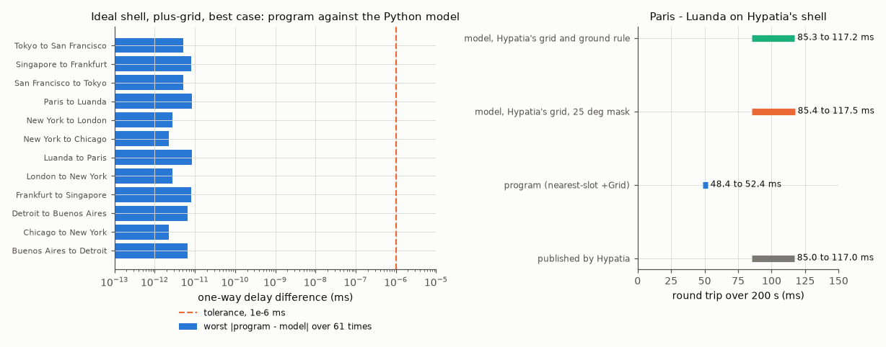
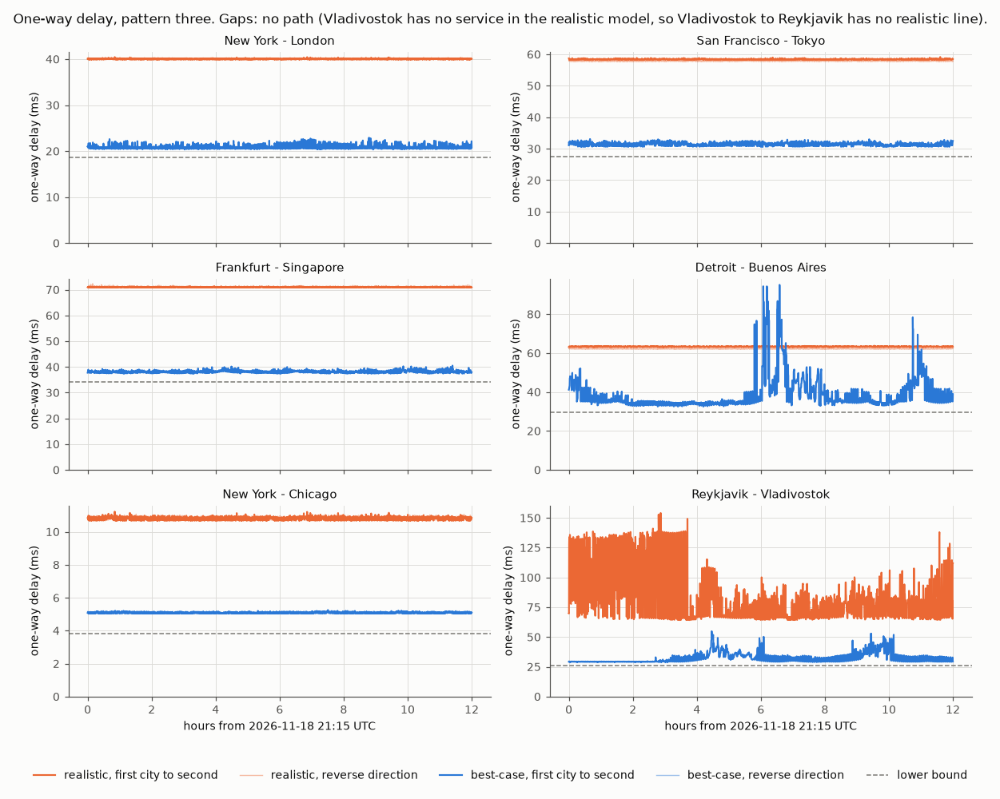
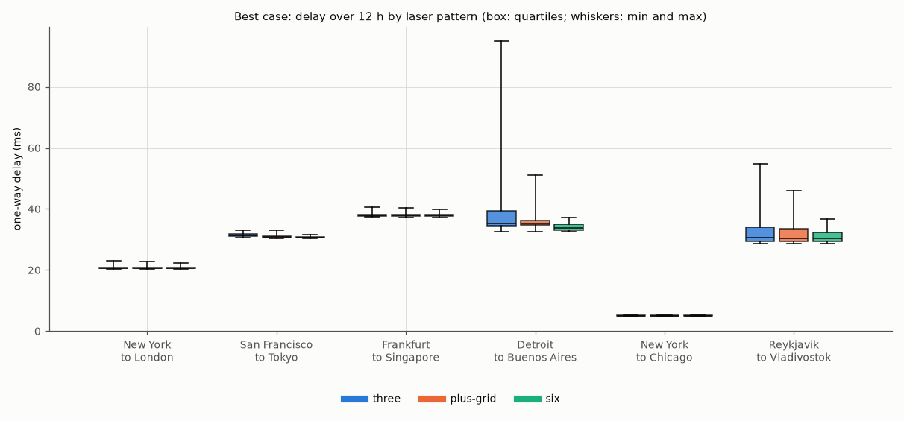
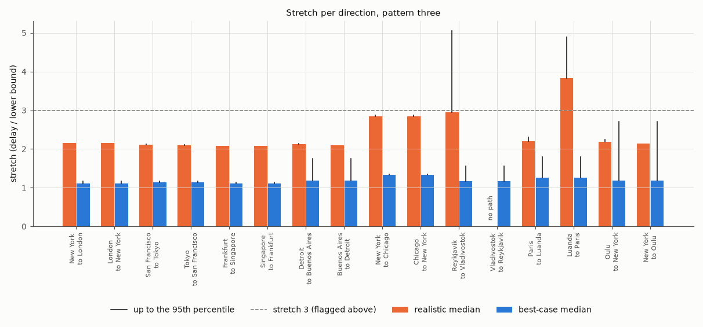
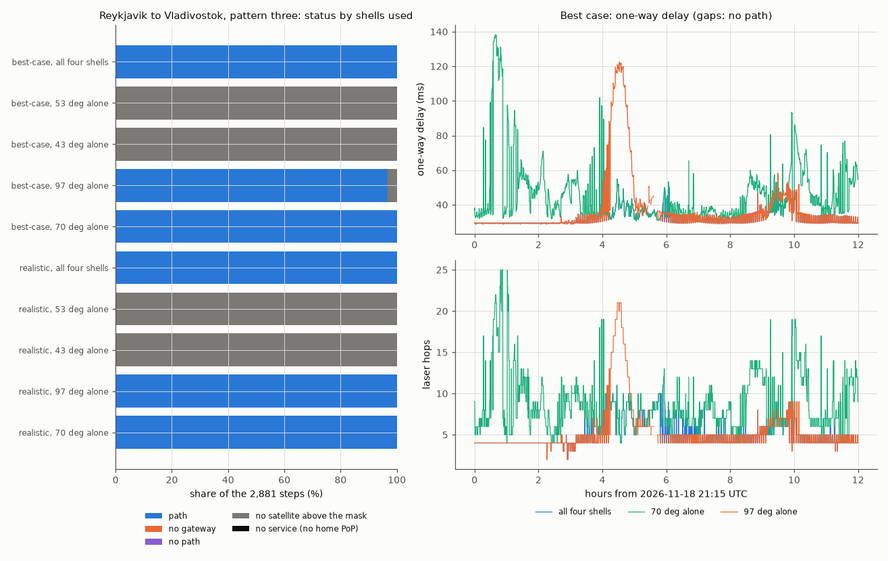
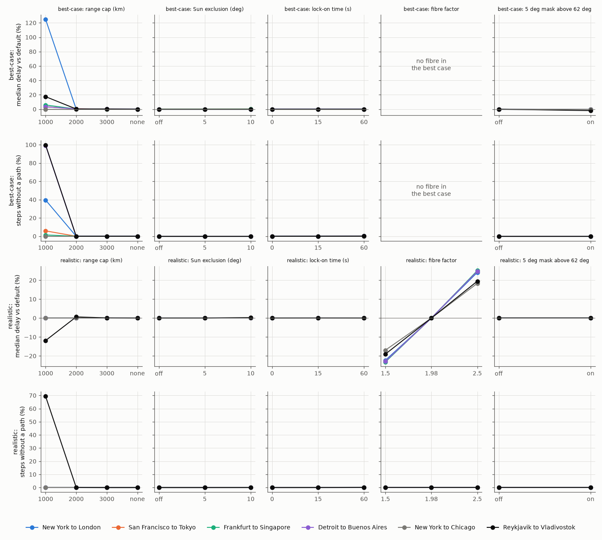
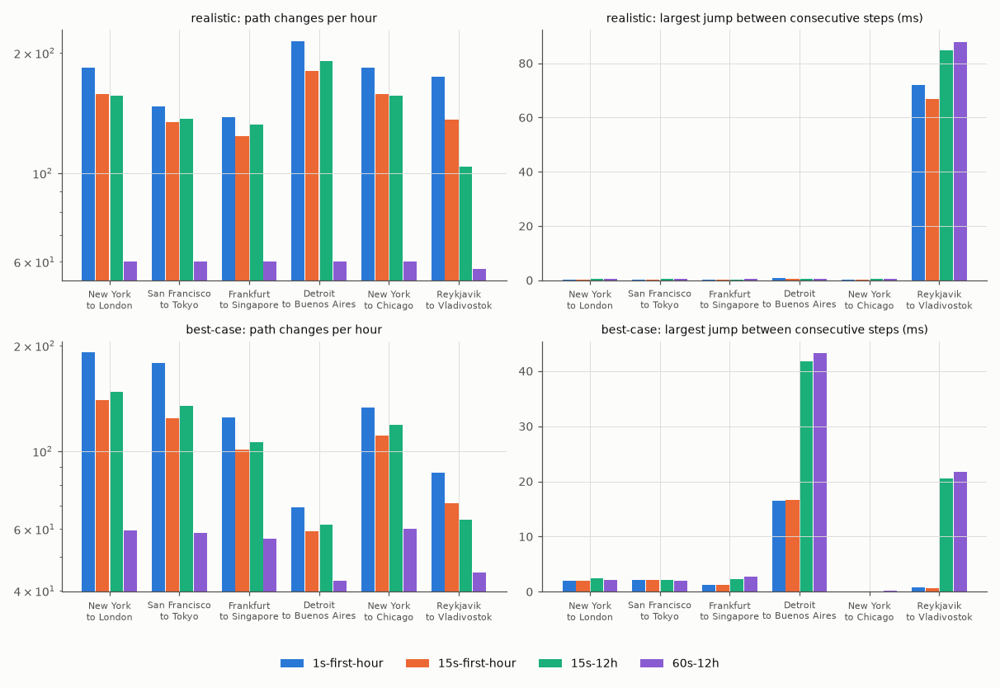

# Phase 2 results: network topology

This report says what Phase 2 built, how it was checked, and what the model gives for the
delay between cities. It uses the terms defined in
[the Phase 2 spec](phase-2-topology.md#2-background-the-terms-this-spec-uses) and
[the Phase 1 spec](phase-1-orbits.md#2-background-the-terms-this-spec-uses). All results come
from the element-set snapshot `data/starlink/2026-11-18/` and the ground data
`data/ground/2026-11-19/`, run from 2026-11-18 21:15 UTC for 12 hours. Every number in this
report was measured by the commands in [Reproducing every number](#reproducing-every-number);
the summaries behind the tables are committed in `docs/phase-2-data/`.

## What was built

- **Shells and planes** (`constellation/`): every satellite is propagated to the start time
  and given a shell, an orbital plane and a position in the plane, or exactly one reason it
  has none. A shell definition can now also be read from a JSON file (`--shells-file`, new in
  this unit, in both programs); the built-in definitions are those of spec section 5.
- **Links** (`topology/`): laser links in three patterns (`three`, `plus-grid`, `six`),
  chosen once at the start and checked for line of sight, range cap, Sun exclusion and
  lock-on at every step; ground links with the FCC elevation masks; the physical checks of
  spec 6.1 on every step's network.
- **Ground** (`ground/`): cities, gateways, points of presence (PoPs), the home-PoP rule and
  fibre as great-circle distance times a fibre factor.
- **Paths** (`network/` and `apps/topology/`): Dijkstra's shortest path under two endpoint
  models. **Realistic** ("Starlink as an ISP"): the sender's dish, its one serving satellite
  (highest elevation), lasers, a satellite over a gateway, the gateway, fibre to the sender's
  home PoP, fibre to the receiver. **Best case** ("Starlink as a backbone"): dishes at both
  cities, each free to use any satellite above the mask, space only.
- **Two programs**: `constellation` (snapshot in, one row per satellite out) and `topology`
  (snapshot, ground data and settings in, one row per city pair, direction and time step out,
  with a summary of every count and check).
- **Python scripts** (this unit): `make_ideal_shell.py` and `validate_topology.py` (the
  ideal-shell cross-check, a CI step), `run_phase2.py` (the 48 real-data runs and their
  summaries), `plot_phase2.py` (the plots below).

## The data

**Satellites.** 11,209 element sets (Phase 1). At 2026-11-18 21:15 UTC, 8,395 satellites are
in 300 planes of four working shells; 2,814 are excluded and carry nothing.

| Shell | Tilt | Height band | Planes | Satellites in planes | Plane size: smallest, median, largest |
|---|---|---|---|---|---|
| 53deg | 53.16° ± 0.3° | 467.5 to 471 km | 121 | 3,196 | 10, 29, 33 |
| 43deg | 43.0° ± 0.3° | 485.5 to 489 km | 93 | 3,187 | 11, 32, 51 |
| 97deg | 97.28° ± 0.3° | 476 to 479 km | 63 | 1,426 | 10, 24, 24 |
| 70deg | 70.0° ± 0.3° | 483.5 to 489 km | 23 | 586 | 10, 26, 44 |

| Exclusion reason | Satellites |
|---|---|
| No laser terminals (first generation) | 553 |
| Direct-to-cell height (350 to 375 km) | 797 |
| 70° at the old height | 168 |
| 53° at 477 km, 8 km above its shell | 474 |
| At a shell's tilt but not its height (raising, lowering) | 575 |
| At no shell's tilt | 57 |
| In a shell but in no plane | 190 |

The evidence for each threshold is in spec section 5 and `docs/img/phase-2/tables.txt`.

**Laser links planned at the start** (from the program's summary):

| Pattern | In plane | Cross plane | Second cross plane | Lasers left unused: no neighbour plane / no free partner | Link-steps down, no line of sight |
|---|---|---|---|---|---|
| `three` | 8,395 | 3,524 | 0 | 0 / 1,347 | 316,922 of 34.3 million (0.9%) |
| `plus-grid` | 8,395 | 7,086 | 0 | 0 / 2,618 | 317,230 of 44.6 million (0.7%) |
| `six` | 8,395 | 7,086 | 6,965 | 0 / 5,478 | 317,273 of 64.7 million (0.5%) |

Each plane links to the next plane in RAAN order wherever a laser between them stays in
range for a whole orbit (spec 4.3), so no laser is left without a neighbour plane. The lasers
without a partner face a gap too wide for a permanent link, or found every partner taken.
At the start, with the links that are up, the 43°, 97° and 70° shells are each one connected
piece under every pattern; the 53° shell is one piece under `plus-grid` and `six`, and under
`three` two of its 3,196 satellites are cut off from the rest (3 pieces). The 97° shell's
planes form a chain, not a ring: its widest RAAN gap (46.5°) is more than a laser at its
height can span for a whole orbit, so nothing crosses it (see the Detroit to Buenos Aires
section below).

The links down without line of sight are mostly in-plane links across the long gaps along
the orbit that every shell has (spec section 5): 110 links are down at the start in all three
patterns, and 110 × 2,881 steps = 316,910 link-steps. The remaining 12, 320 and 363
link-steps (`three`, `plus-grid`, `six`) are other links down for a short time; the program
does not export the state of each link, so which links they are is not reported.

**Ground.** 196 operational gateways from the community list (208 in all, United States and
territories only) and 45 gateways ASSUMED at PoPs that have no listed gateway within 500 km,
all outside the United States and Canada. 65 PoPs. Home PoPs, from SpaceX's address files:

| City | Home PoP | Level | City | Home PoP | Level |
|---|---|---|---|---|---|
| New York | lga (New York) | city | Chicago | ord (Chicago) | city |
| London | lhr (London) | city | Reykjavik | lhr (London) | city |
| San Francisco | sjc (San Jose) | region | Vladivostok | none | none |
| Tokyo | nrt (Tokyo) | city | Paris | mad (Madrid) | city |
| Frankfurt | fra (Frankfurt) | country | Luanda | jnb (Johannesburg) | city |
| Singapore | sin (Singapore) | city | Oulu | arn (Stockholm) | country |
| Detroit | ord (Chicago) | city | Buenos Aires | eze (Buenos Aires) | city |

**City pairs.** Six study pairs (spec) and two validation pairs: Paris to Luanda (the one
pair Hypatia prints for the Starlink first shell) and Oulu to New York (measured in "Starlink
in Northern Europe"). Both validation pairs were already in `data/ground/cities.json`; no
city or pair was added (see [Hypatia's published numbers](#2b-hypatias-published-numbers)).

## Three layers of proof

Each layer checks a different part, against a reference that does not share the program's
code for that part.

### 1. Physically possible: every network, every step

The program checks every step's network against the rules of spec 6.1 and exits with
status 1 on any failure. Over all 48 runs of this report (2,881 steps each for the 12-hour
runs; together 1.49 billion laser link-steps), every count was zero: no laser below
80 km, none over the range cap, no satellite over its laser budget, no one-sided link, no
link between shells or to an excluded satellite, no ground link below its mask, and no delay
below its lower bound. `docs/phase-2-data/runs.csv` holds every count of every run.

### 2. Agrees with an independent model on Hypatia's shell (the `validate-topology` CI step)

**The shell.** `python/make_ideal_shell.py` writes Hypatia's first Starlink shell exactly as
Hypatia's generator does (repository `snkas/hypatia`, `satgenpy/satgen/tles/
generate_tles_from_scratch.py` with the constants of
`paper/satellite_networks_state/main_starlink_550.py`): 72 planes 5° apart in RAAN, 22
satellites per plane 16.36° apart, every odd plane shifted by half a slot (their
`PHASE_DIFF`), inclination 53°, eccentricity 0.0000001, mean motion 15.19 revolutions per
day, epoch 2000-01-01 00:00 UTC (their TLE epoch; that their runs start there is read from
their dynamic-state code, which takes each time as the epoch plus the time since it, and the
agreement below supports it). These are
their values, used unchanged because their published round-trip times were computed with
them.

One consequence, measured: with 15.19 revolutions per day the mean orbit radius is
6,886.9 km, so the satellites fly about 509 km above the equator (mean height 515.6 km above
the WGS-84 ellipsoid), not the 550 km their file and the spec state. 550 km would need about
15.05 revolutions per day. The program's mask is chosen by the shell's mean height, and
515.6 km is in the FCC's 25° band, so the mask is the one Hypatia intended.

**How the snapshot files are filled.** Planes 1 to 71 are in `supgp.json`. Plane 0 is only in
`gp.json`. `gp.json` also holds a decoy for every satellite of planes 1 to 71, with RAAN 1.25°
and mean anomaly a quarter slot further on, and an epoch one hour later than the
supplemental set. The documented rule (supplemental set where one exists, whatever the
epochs) picks the true set for every satellite. A program that preferred the standard file,
or the latest epoch across both files, would fly the decoys; one that ignored the standard
file would lose plane 0.

**The independent model** (`python/validate_topology.py`) shares no code with the program:
positions from python-sgp4 built from plane and slot (not read back from the files), TEME to
ITRS with Skyfield's own frame code and the same `finals2000A.all`, times built from calendar
fields; the +Grid built from plane and slot indices; line of sight above 80 km; the 25° mask
from the WGS-84 ellipsoid normal at each city; its own Dijkstra.

**The checks and what they measured.**

| Check | Result | Tolerance |
|---|---|---|
| Plane and position in plane of every satellite (`constellation`) | 1,584 of 1,584 as constructed; 72 planes of 22 | exact |
| Element source of every satellite | plane 0 standard, the others supplemental, as the rule says | exact |
| Satellites, laser links (`topology` summary) | 1,584 in 72 planes; 3,168 links (1,584 in plane, 1,584 cross plane), no laser without a partner, so 4 per satellite; no link down | exact |
| Status, laser hops, first and last satellite of every row (976 rows: 16 directions × 61 times, one hour every minute) | all equal (732 with a path, 244 with no satellite above the mask: Reykjavik and Oulu are above 64° north) | exact |
| One-way delay of every row with a path | median difference 1.7e-12 ms, worst 8.6e-12 ms (2.6 µm of path) | 1e-6 ms |

**Why 1e-6 ms.** Phase 1 measured the program's Earth-fixed positions within 0.43 mm of
Skyfield's; nearly all of that was Skyfield's TIO locator, which is close to zero at the
2000 epoch, which is the likely reason the differences measured here are far smaller still.
The tolerance allows for the 2026 difference on long paths: a path of 40 links (the longest
here has 11 laser hops, 13 links) with 0.43 mm at each end of each link would move a delay by
at most 3.5 cm, 1.2e-7 ms. The tolerance is about ten times that. A real error moves a delay
by much more: a different laser, satellite or ground link changes a path by tens of
kilometres, 0.1 ms or more.

**The check fails on real errors.** Each of these was planted temporarily in the C++ code (in
a copy), the programs rebuilt and the step run:

| Planted error | What the step reported |
|---|---|
| Mask 24.5° instead of 25° above 500 km | 112 problems; first, San Francisco to Tokyo at 00:04: a 5-hop path where the model has 6 hops, 0.74 ms shorter |
| Standard element set preferred over the supplemental one | 1,484 problems; first, satellite 100022 in plane 1 at position 8 instead of 0, from the standard file |
| Cross-plane candidates matched longest first instead of shortest first | 1,142 problems; first, New York to London at 00:00: 1 laser hop where the model has 3, 0.24 ms shorter |

Every one made the script exit with status 1.

**The program's +Grid is not Hypatia's +Grid on this shell.** The model above links slot s of
plane o to the slot of plane o+1 nearest to it. That slot follows from the indices alone:
rotating a plane by ΔΩ about the pole moves a point along the orbit by ΔΩ·cos i to first
order (5° × cos 53° = 3.01°), so the nearest slot of the next plane is the one whose argument
of latitude is closest to u − 3.01°. With Hypatia's half-slot shift of odd planes this is the
same index from odd to even planes, and the index one below from even to odd planes. A greedy
nearest-distance matching written again in Python (the program's documented rule, spec 4.3)
gives exactly this grid: all 1,584 cross-plane links the same.

Hypatia instead links slot s to slot s of the next plane, always (`generate_plus_grid_isls`,
`isl_shift = 0`). The two grids share the 792 odd-to-even links and differ in the 792
even-to-odd ones, where Hypatia's link is the farther diagonal: Hypatia's cross-plane links
are 620 to 1,426 km long (mean 1,045 km), the nearest-slot ones 620 to 784 km (mean 705 km).
The program therefore has a different, shorter laser grid, and on north-south paths a much
shorter route. Over the hour above, Hypatia's grid gives a different delay in 524 of the 732
rows with a path (median difference over all 732: +0.55 ms one-way), slower by 21 to 35 ms
one-way for Detroit to Buenos Aires and 26 to 35 ms for Paris to Luanda; for east-west pairs the difference is small (New York to London:
−0.34 to +1.58 ms).

### 2b. Hypatia's published numbers

The Hypatia paper (Kassing et al., "Exploring the 'Internet from space' with Hypatia",
IMC 2020) and its repository print a round-trip time for one pair of cities on the Starlink
first shell, and only one:

| Pair | Published | Where |
|---|---|---|
| Paris - Luanda | longest 117 ms, shortest 85 ms, over a 200 s run | Paper, section 6 ("Visualizing LEO networks") and the caption of Fig. 13; repository `README.md`, the Paris-Luanda figure ("Left: 117 ms, Right: 85 ms") |

The paper's other per-pair values (section 4.1: Rio de Janeiro to St. Petersburg 96 to 111 ms,
Manila to Dalian 25 to 48 ms, Istanbul to Nairobi 47 to 70 ms) are for Kuiper's K1 shell, not
Starlink. The repository's `paper/README.md` prints no round-trip times. Paris and Luanda
were already a validation pair in `data/ground/cities.json`, at city-centre coordinates that
are 0.4 km and 6 km from Hypatia's ground-station list
(`paper/satellite_networks_state/input_data/ground_stations_cities_sorted_by_estimated_2025_pop_top_100.basic.txt`),
which moves a round trip by under 0.05 ms, so no file was added. Hypatia's code and data were
read on the web, not downloaded into the repository and not run.

The same 200 s from the epoch, every second (the paper's analyses use 100 ms steps, section
5.3; a 1 s step can miss a short extreme, which would narrow the range here slightly):

| | Shortest round trip | Longest round trip | From Hypatia's |
|---|---|---|---|
| Hypatia, published | 85 ms | 117 ms | |
| Independent model with Hypatia's same-index grid, 25° mask | 85.4 ms | 117.5 ms | +0.5%, +0.4% |
| Independent model with Hypatia's grid and Hypatia's ground-link rule | 85.3 ms | 117.2 ms | +0.3%, +0.2% |
| **The program** (`plus-grid`, best case) | **48.4 ms** | **52.4 ms** | **−43%, −55%** |

The independent model, given Hypatia's grid, reproduces Hypatia's numbers to half a percent.
This checks the shell, the epoch and time, the cities, the mask and the shortest path against
Hypatia, and through the exact agreement above it checks the program's geometry too. The
program itself is 43% and 55% below Hypatia: not an error, but the different grid. Its
nearest-slot +Grid lets a north-south path cross planes cheaply, where Hypatia's paper itself
notes that this path "takes 9 zig-zag hops" at its longest. The lower bound for Paris to
Luanda is 43.4 ms round trip; the program's 48.4 to 52.4 ms is 1.12 to 1.21 times that.

Hypatia's ground-link rule is a straight-line distance of at most
√(940.7² + 550²) = 1,089.7 km. At 550 km that is 26.2° elevation, stricter than 25°; at the
shell's real height it is 23.6°, slightly looser. Here it changes the round trip by 0.1 to
0.3 ms.

The CI step therefore holds to 20% of Hypatia's values the model built with Hypatia's grid,
and prints the program's values next to it. This is the chain spec 6.2 describes: the
program against the independent model exactly, and the independent model against Hypatia.
The program has no same-index grid, because such a grid has no meaning on the real
constellation, where planes hold different numbers of satellites.



### 3. Plausible against real Starlink (reported, never pass or fail)

**Oulu to New York.** "Starlink in Northern Europe" (Ullah et al., arXiv 2502.15552, v2,
section V-A) reports a median round trip of 143 ms over Starlink and 103 ms over a terrestrial
connection, from Oulu to a server in New York (Hostkey). Their setup: a Flat High Performance
dish on a car roof in Oulu parking areas, a Mobile Priority subscription, the Windows default
`ping` (32-byte packets), 774 samples per server, measurement days in May and June 2024;
their traceroute showed the dish using ground stations in Germany or Belgium.

This model's realistic round trip (the program's `round_trip_ms`: Oulu to New York plus New
York to Oulu at the same step): median 92.0 ms, 5th to 95th percentile range up to 93.2 ms,
minimum 91.1 ms; the same for all three patterns except the maximum (140.4 / 116.3 / 111.8 ms for `three` / `plus-grid` / `six`). That is 51 ms below the
Starlink measurement, and also below the terrestrial one. Every difference between the two:

- The model has only propagation delay. The measurement includes the Starlink link layer
  (scheduling on the radio link, which the next paper puts at about 40 ms round trip for the
  bent pipe, against this model's 6 to 10 ms), processing and queueing in every router, the
  server's response time and Windows' timer.
- The model sends Oulu's traffic down at an ASSUMED gateway at the Stockholm PoP (`arn`,
  chosen at country level: SpaceX's files list no block in Oulu or its region); the measured dish used
  ground stations in Germany or Belgium. The measured path from there to New York is not
  known; the model uses a great circle times 1.98 from Stockholm.
- New York to Oulu uses New York's home PoP and the real New York gateway; the measurement's
  reply came over the server's provider and the internet.
- Their dish was a mobile terminal on a Mobile Priority plan, in 2024; the model is the
  constellation of 2026-11-18.

**The bent pipe.** "A Multifaceted Look at Starlink Performance" (Mohan et al., WWW 2024,
arXiv 2310.09242, section 6.1) measured, with ICMP traceroutes from 98 Starlink RIPE Atlas
probes in 21 countries between December 2022 and September 2023, a bent-pipe round trip
(terminal to the first hop at the ground station) of 36 to 48 ms, "hovering around 40 ms"
for almost all countries, and about 5 ms more from the ground station to the PoP.

This model, realistic, pattern `three`, round trip from the dish (twice uplink, lasers and
downlink; to the home PoP, plus twice the gateway-to-PoP fibre):

| Sender | Home PoP | Dish to gateway, median | Dish to home PoP, median (95th percentile) |
|---|---|---|---|
| New York | lga | 6.5 ms | 6.5 ms (6.8) |
| London | lhr | 6.4 ms | 6.4 ms (6.6) |
| San Francisco | sjc | 6.6 ms | 6.7 ms (7.1) |
| Tokyo | nrt | 6.5 ms | 6.5 ms (7.0) |
| Frankfurt | fra | 6.4 ms | 6.4 ms (6.8) |
| Singapore | sin | 6.6 ms | 6.6 ms (7.4) |
| Detroit | ord | 7.5 ms | 7.5 ms (8.0) |
| Buenos Aires | eze | 6.6 ms | 6.6 ms (7.1) |
| Chicago | ord | 6.5 ms | 6.6 ms (6.8) |
| Paris | mad | 10.6 ms | 19.6 ms (23.9) |
| Oulu | arn | 9.7 ms | 9.7 ms (12.0) |
| Reykjavik | lhr | 31.3 ms | 41.9 ms (152.6) |
| Luanda | jnb | 25.0 ms | 50.6 ms (96.8) |

Propagation alone accounts for 6 to 8 ms of the measured 40 ms where a gateway is near the
city. The rest, about 30 ms, is what the model leaves out: Starlink's radio scheduling and
processing. The model's numbers are therefore a lower bound on a real round trip, never an
estimate of it. Where the gateway is assumed at the PoP itself (every city outside the United
States here), the gateway-to-PoP fibre is zero; the measured 5 ms suggests real gateways sit
some hundreds of kilometres from their PoP.

**Directions whose median stretch exceeds 3** (spec 6.3; `docs/phase-2-data/flagged.csv`):

| Direction | Model, pattern | Median stretch | Why |
|---|---|---|---|
| Luanda to Paris | realistic, `three` | 3.82 | Luanda's home PoP is Johannesburg (`jnb`, SpaceX's own file). Traffic goes south 2,500 km to a gateway near Johannesburg or Kampala (both assumed), then by fibre to Johannesburg and from there 8,700 km north to Paris, times 1.98. |
| Luanda to Paris | realistic, `plus-grid` | 3.28 | The same; more steps reach the Johannesburg gateway with fewer laser hops. |
| Luanda to Paris | realistic, `six` | 3.23 | The same. |

Close to the line: Reykjavik to Vladivostok, realistic `three`, median stretch 2.94 (below),
explained below. New York to Chicago, realistic, 2.84: on a short pair the 1,000 km up and
down to a satellite are a large share of the path.

## Results: Starlink as an ISP and as a backbone

Median one-way delay over the 12 hours (2,881 steps every 15 s), and median stretch.
Realistic is "Starlink as an ISP"; best case is "Starlink as a backbone". Full statistics
(minimum, 95th percentile, maximum, hops, gateways) per direction: `docs/phase-2-data/main.csv`.

| Direction | Lower bound | Realistic (all patterns) | Best case `three` | Best case `plus-grid` | Best case `six` |
|---|---|---|---|---|---|
| New York → London | 18.58 ms | 40.06 ms (2.16) | 20.68 ms (1.11) | 20.67 ms (1.11) | 20.67 ms (1.11) |
| London → New York | 18.58 ms | 39.98 ms (2.15) | same as above | | |
| San Francisco → Tokyo | 27.60 ms | 58.43 ms (2.12) | 31.39 ms (1.14) | 30.84 ms (1.12) | 30.69 ms (1.11) |
| Tokyo → San Francisco | 27.60 ms | 57.87 ms (2.10) | | | |
| Frankfurt → Singapore | 34.22 ms | 70.95 ms (2.07) | 37.91 ms (1.11) | 37.89 ms (1.11) | 37.81 ms (1.11) |
| Singapore → Frankfurt | 34.22 ms | 71.04 ms (2.08) | | | |
| Detroit → Buenos Aires | 29.74 ms | 63.28 ms (2.13) | 35.17 ms (1.18) | 35.30 ms (1.19) | 33.69 ms (1.13) |
| Buenos Aires → Detroit | 29.74 ms | 62.21 ms (2.09) | | | |
| New York → Chicago | 3.82 ms | 10.83 ms (2.84) | 5.08 ms (1.33) | 5.08 ms (1.33) | 5.08 ms (1.33) |
| Chicago → New York | 3.82 ms | 10.86 ms (2.85) | | | |
| Reykjavik → Vladivostok | 26.25 ms | 77.23 / 68.34 / 66.59 ms (2.94 / 2.60 / 2.54) | 30.54 ms (1.16) | 30.47 ms (1.16) | 30.43 ms (1.16) |
| Vladivostok → Reykjavik | 26.25 ms | no service | | | |
| Paris → Luanda | 21.70 ms | 47.75 / 44.13 / 44.03 ms (2.20 / 2.03 / 2.03) | 27.18 ms (1.25) | 26.21 ms (1.21) | 24.75 ms (1.14) |
| Luanda → Paris | 21.70 ms | 82.97 / 71.06 / 70.02 ms (3.82 / 3.28 / 3.23) | | | |
| Oulu → New York | 21.30 ms | 46.57 ms (2.19) | 25.32 ms (1.19) | 25.19 ms (1.18) | 24.96 ms (1.17) |
| New York → Oulu | 21.30 ms | 45.44 ms (2.13) | | | |

Where three values are given they are `three` / `plus-grid` / `six`. The best case is the
same in both directions (the same graph, any satellite at either end). Every direction had a
path at every step except: Vladivostok has no home PoP (no Russian address blocks in SpaceX's
files), so Vladivostok → Reykjavik realistic is "no service" throughout.

What this shows:

- **As an ISP, the laser pattern hardly matters for the study pairs.** For the five pairs
  other than Reykjavik's, every realistic path at every step and in every pattern is a bent
  pipe: up to the serving satellite and straight down to a gateway near the sender (0 laser
  hops), then fibre through the home PoP. Realistic stretch is 2.07 to 2.16 for the long
  pairs, a little above the fibre factor (1.98) because of the way up and down. The pattern
  matters only where the sender has no gateway in reach of its serving satellite: Reykjavik,
  Luanda (2 laser hops median) and, rarely, Oulu.
- **As a backbone, Starlink is close to the lower bound**: stretch 1.11 to 1.19 for the long
  pairs, 1.33 for New York to Chicago. Realistic is 1.8 to 2.1 times the best case for the
  five pairs (New York to London 1.94, San Francisco to Tokyo 1.86, Frankfurt to Singapore
  1.87, Detroit to Buenos Aires 1.80, New York to Chicago 2.13), and 2.53 for Reykjavik.
- **The patterns differ in the tails more than in the medians.** Best-case medians are within
  1 ms across patterns except Detroit to Buenos Aires (35.17 / 35.30 / 33.69 ms) and Paris to
  Luanda (27.18 / 26.21 / 24.75 ms); the maxima differ much more: Detroit to Buenos Aires
  95.1 / 51.0 / 37.2 ms, Reykjavik to Vladivostok 54.8 / 45.9 / 36.8 ms, Paris to Luanda
  119.1 / 46.2 / 28.6 ms, Oulu to New York 143.4 / 56.3 / 36.1 ms (`three` / `plus-grid` /
  `six`).
- **Fibre beats Starlink for New York to Chicago as an ISP** (10.8 ms against a fibre-only
  estimate of 3.82 × 1.98 = 7.6 ms), as the spec expected; as a backbone Starlink would win
  (5.1 ms).







### The known results, checked

The previous unit measured these with pattern `three`; each is confirmed or corrected here
from the 12-hour runs.

| Earlier result | This report |
|---|---|
| Realistic study paths except Reykjavik's are bent pipes to a gateway near the sender, then fibre | Confirmed: 0 laser hops at every step for the ten directions of the five pairs, in all three patterns; gateways New York, Chicago, Santa Clara (6 steps San Jose) and assumed ones at lhr, nrt, fra, sin, eze |
| Realistic stretch about the fibre factor (≈ 2.1); the pattern hardly matters there | Confirmed: 2.07 to 2.16 for the long pairs, identical in all patterns |
| Realistic roughly twice the best case | Confirmed: 1.80 to 2.13 for the five pairs, 2.53 for Reykjavik |
| Reykjavik → Vladivostok realistic uses lasers to the assumed London gateway, swings widely (median 78 ms, max 154 ms), a few steps with no gateway | Swings confirmed: median 77.2 ms, maximum 154.1 ms; London is the gateway at 1,987 of 2,881 steps, but also Madrid (296), Stockholm (272), Fortaleza (219) and Dakar (66). Corrected: no step without a gateway since the 97° shell is connected (spec 4.3). Cause below |
| Vladivostok → Reykjavik realistic is "no service" throughout | Confirmed: 2,881 of 2,881 steps |
| Detroit ↔ Buenos Aires best case has a long tail, up to 95 ms and 25 hops | Confirmed: maximum 95.1 ms, 25 hops, 95th percentile 52.2 ms against a median of 35.2 ms. Cause below |

### Why Detroit to Buenos Aires has a long tail in the best case

A best-case path stays in one shell (no lasers between shells), so both cities must reach the
same shell. Over the 12 hours the best path is in the 70° shell at 1,433 steps and in the 97°
shell at 1,395: their planes run nearly north-south, the direction of this pair. At 183 steps
(6.4%) the delay is above 50 ms; there the best path is in the 70° shell (96 steps), the 53°
shell (49), the 97° shell (34, at most 55.8 ms) or the 43° shell (4), with up to 25 laser
hops. The worst step (95.1 ms) is in the 53° shell.

The runs with one shell alone show why:

- **The 97° shell** is one connected piece under `three` (spec 4.3: each plane links to the
  next wherever a laser stays in range for a whole orbit), but a poorly connected one. Its 63
  planes have ten RAAN gaps more than 3 times the median gap of 3.0°, from 10.7° to 46.5°.
  Planes 46.5° apart in RAAN meet at 46.1°, more than the 39.2° a laser at 477 km can span
  once an orbit, so nothing crosses that gap and the planes form
  a chain, not a ring; under `three` the 38.7° gap is crossed by only 3 links (19 with
  `plus-grid`). Alone, the shell connects Detroit and Buenos Aires at every step where both
  cities see one of its satellites (2,463 of 2,881; no coverage at 418), with a median of
  35.5 ms but a 95th percentile of 302 ms and a maximum of 617 ms (127 laser hops): a path
  between planes on the two sides of the 46.5° gap must go the long way round the chain. At
  the 183 slow steps of the full run, a city sees no 97° satellite at 112; at the other 71 the
  97° shell alone has a path, median 54.6 ms.
- **The 70° shell alone** gives a median of 63.6 ms at those steps (maximum 123 ms): only 23
  planes 13° apart, so a path must zig-zag sideways.
- **The 53° and 43° shells alone** give medians of 80.4 ms and 109.3 ms there: their planes
  are tilted away from the pair's direction, and under `three` crossing k planes sideways
  takes about 2k hops, since each satellite has a cross-plane laser on one side only.

With `plus-grid` the same 183 steps cost 37.3 ms median and 51.0 ms at most; with `six` the
whole run stays below 37.2 ms. So the tail is the `three` pattern's single cross-plane laser,
made visible whenever the near-polar shells cannot give the pair a short path.

### Why Reykjavik to Vladivostok swings in the realistic model

Reykjavik (64.1° N) is beyond the 53° and 43° shells' reach above the mask; only the 70° and
97° shells serve it. The realistic model serves it with the highest satellite, whatever its
shell: 70° at 1,571 steps, 97° at 1,310. The home PoP is London (`lhr`).

- **Served by the 70° shell**, the path lasers to a satellite over the assumed London gateway
  (1,298 steps; median 66.8 ms) or Stockholm (257).
- **Served by the 97° shell**, the path comes down at the assumed London gateway at 689 of
  1,310 steps. The 97° shell is connected (see above), but through few links: from the
  serving satellite the laser path to a satellite over London is often long, and coming down
  at the assumed gateways of Madrid (291 steps), Fortaleza in Brazil (219 steps, 132 to
  141 ms) or Dakar (66), then going by fibre back to London and on to Vladivostok, is then the
  smaller total. The serving satellite changes every half minute or so (104 times in the
  first hour at 1 s steps), and its shell with it, so the delay jumps between about 65 ms and
  140 ms from one step to the next (largest jump: 84.9 ms).
- **A gateway at every step.** With the earlier neighbouring-planes rule the 97° shell broke
  into pieces and 6 steps had no gateway; now none has, and the 97° shell alone also finds a
  gateway at all 2,881 steps. The maximum (154.1 ms) is a 97° serving satellite coming down at
  the assumed Tokyo gateway (2 steps).

`plus-grid` and `six` reduce the swings (medians 68.3 and 66.6 ms) and the maximum (147.7 and
111.3 ms). With `plus-grid` a 97° serving satellite still comes down at Fortaleza at 36
steps; with `six`, never. A serving rule that took connectivity into account would avoid
the rest; the model's rule is the highest satellite (spec 4.5).



## Sensitivity

Pattern `three`, one parameter changed at a time from the defaults (12 hours, every 15 s).
Change of the median one-way delay against the default, and steps without a path; full
statistics in `docs/phase-2-data/sensitivity.csv`.

- **Range cap.** 3,000 km changes nothing that matters (best-case medians of the study pairs
  within 0.3%; 604,755 more link-steps down). 2,000 km: medians within 0.6% but tails grow
  (Detroit to Buenos Aires maximum 112.7 ms; Reykjavik to Vladivostok 60.2 ms). **1,000 km
  breaks the network**: 21.4 million link-steps over the cap (62% of all), most cross-plane links of the
  sparser shells. Best case, Detroit to Buenos Aires has a path at only 18 of 2,881 steps,
  Reykjavik to Vladivostok at 7, New York to London at 1,741 (median +125%). Realistic is
  unaffected for the bent-pipe pairs; Reykjavik has no gateway at 1,999 steps.
- **Sun exclusion.** 5°: 105,920 link-steps down (0.3%); 10°: 446,725 (1.3%). Medians move by
  under 0.3%; at 10° the best-case maximum for San Francisco to Tokyo rises from 33.1 to
  41.3 ms and the 95th percentile for Reykjavik to Vladivostok from 40.7 to 44.4 ms.
- **Lock-on time** (15 s, 60 s). The only effect is at the start: the program treats every
  link as just come up at the first step (documented in `link_state.hpp`), so with 15 s no
  laser carries traffic at the first step and with 60 s at the first four (11,810 and 47,240
  link-steps locking on: one and four steps' worth of the 11,809 links up at the start, plus
  one link that comes up once later in the run). Apart from that one link, no laser link
  comes up during the 12 hours, so nothing else changes. With neighbours fixed at the start and
  only line of sight as a limit, lock-on can matter only together with Sun exclusion or a
  range cap, which these one-at-a-time runs do not combine.
- **Fibre factor** (realistic only). 1.5 lowers the medians by 17% to 23%, 2.5 raises them by
  18% to 25%: realistic delay is mostly fibre (New York to London 31.1 / 40.1 / 49.7 ms at
  1.5 / 1.98 / 2.5).
- **5° mask above 62° latitude.** Changes only Reykjavik (64.1° N) and Oulu (65.0° N): best
  case Reykjavik to Vladivostok median −1.9% (29.96 ms) and maximum 54.8 → 49.9 ms. Realistic
  is unchanged.



## The time step

What does the 15 s step change? Runs of the main settings every 60 s for 12 hours
and every 1 s for the first hour are compared with the 15 s run restricted to the same window
(`docs/phase-2-data/timestep.csv`). This shows what the step size changes in this model; it
says nothing about why Starlink reassigns dishes every 15 s (that interval is inferred from
measurements, spec 4.7).

- **The 60 s run is exactly the 15 s run at every fourth step** (checked row by row): the
  network at an instant does not depend on the step, since neighbours are chosen once at the
  start.
- **A 60 s step misses most changes.** Realistic, pattern `three`: the serving satellite
  changes at 720 of 720 intervals at 60 s, so every sample shows a new satellite and the
  changes in between are invisible; at 15 s it changes 1,879 times in 12 hours (New York to
  London), about 157 per hour.
- **A 15 s step misses some changes that 1 s shows.** First hour, realistic: 184 changes of
  serving satellite at 1 s against 158 at 15 s (New York to London), 214 against 180
  (Detroit to Buenos Aires); a path holds 19 s (median) at 1 s. Best case: 141 against 121
  changes of first satellite (New York to London), 154 against 108 (San Francisco to Tokyo).
  So 14% to 30% of the changes seen at 1 s do not show at 15 s: two or more changes fall
  between the same two 15 s steps, or a change is undone before the next step.
- **The largest jump between consecutive steps** grows with the step for smooth paths
  (realistic New York to London: 0.17 ms at 1 s and 0.26 ms at 15 s in the first hour; 0.41 ms
  at 15 s and 0.47 ms at 60 s over 12 hours) and is set by path changes for the others
  (Reykjavik realistic: 72 ms at 1 s, 67 ms at 15 s in the first hour; 85 ms and 88 ms over
  12 hours at 15 s and 60 s; Detroit to Buenos Aires best case: 17 ms in the first hour, 42 ms
  over 12 hours).
- **The delay distribution barely changes**: medians agree within 0.05 ms between 1 s and
  15 s in the first hour, except Detroit to Buenos Aires best case (36.71 against 36.93 ms)
  and Reykjavik to Vladivostok realistic (0.15 ms with `three`, 0.62 ms with `six`); between
  15 s and 60 s over 12 hours they agree within 0.25 ms, except Luanda to Paris realistic
  `three` (82.97 against 80.57 ms). Rare events are sampled differently (Reykjavik realistic
  95th percentile 132.6 ms at 15 s, 132.4 ms at 60 s).



## Assumptions and simplifications, and what they cost

| Assumption or simplification | Effect, and which way it biases the result |
|---|---|
| Which planes link: each plane to the next in RAAN order, a link only where a laser stays in range for a whole orbit (both satellites on circular orbits at the same rate, spec 4.3). This project's assumption; SpaceX publishes nothing on which planes link | Joins the 97° shell's groups of planes across RAAN gaps up to 38.7°, with few links; nothing crosses its 46.5° gap, so its planes form a chain. A real operator could link differently (for example across that gap at times, re-pointing lasers), which would shorten the long 97° paths |
| The cross-plane rule of `three` (even positions face east, odd west) and the layout of `six` are this project's assumptions; SpaceX has published neither | `three` gives the long tails above (Detroit to Buenos Aires up to 95 ms, against 51 ms with `plus-grid`); the real layout could be better or worse. Medians barely depend on it |
| Neighbours chosen once at the start and kept for 12 hours | No re-planning when a link is lost: pessimistic for a real operator, which re-points lasers. 0.5% to 0.9% of link-steps are down for line of sight, nearly all of them at every step |
| Excluded satellites (2,814) carry nothing | Pessimistic: some (the 474 satellites 8 km above the 53° shell, raising satellites) surely carry traffic |
| No lasers between shells | Pessimistic for the best case: it is why Detroit to Buenos Aires depends on the 70° and 97° shells alone |
| Delay is propagation only: no queueing, processing, radio scheduling or Wi-Fi | Optimistic, by about 30 ms per round trip on the bent pipe (measured 40 ms against 6 to 8 ms here) |
| Gateways: the community list (United States and territories only) plus 45 gateways ASSUMED at PoP sites elsewhere | Outside the United States the point where traffic comes down is assumed, not known. Placing it at the PoP itself makes the gateway-to-PoP fibre zero: slightly optimistic (measured: about 5 ms round trip from ground station to PoP) |
| The community coordinates contain errors; two PoPs were corrected by hand (Ashburn, Brasília) | Others may remain; city-level coordinates are good to a few tens of kilometres, about 0.1 ms of fibre |
| Fibre as great circle × 1.98 | A published estimate for good routes; real routes between two given cities are often worse. Realistic delay moves −17% to +25% for factors 1.5 to 2.5 |
| Home PoP: the PoP with most of the city's address blocks, else the region's, else the country's | Follows SpaceX's own files, which give surprises (Paris → Madrid, Luanda → Johannesburg). San Francisco, Frankfurt and Oulu use the region or country level |
| Vladivostok has no service (no Russian blocks in SpaceX's files) | Reported as "no service", never as a delay |
| Serving satellite: the highest one above the mask | Ignores whether it can reach a gateway: the cause of the Reykjavik swings |
| The 15 s step is inferred from measurements | 15% to 30% of the changes seen at 1 s are missed at 15 s; delay distributions are unaffected |
| Ground data dated 2026-11-19, a day after the element sets | Gateways and PoPs change slowly; no effect expected |
| 12 hours from the snapshot time, the limit set in Phase 1 | SGP4 positions are good to about 1 km here; 1 km is 3.3 µs of delay |
| Masks by the shell's mean height (FCC DA 26-36): 20° for the working shells (all between 400 and 500 km) | The 5° high-latitude allowance moves only the cities above 62° |

## Known limits

- **One snapshot and one 12-hour window**; every result is for 2026-11-18 21:15 UTC onward.
- **The program does not export its link list**, so the ideal-shell cross-check compares
  links through their effect on every path (hops, end satellites, delay to 1e-12 ms) and
  through the counts. A `--links-out` option would allow comparing link sets directly.
- **The program is compared with Hypatia through the independent model, not directly.** Its
  `plus-grid` is a different, shorter set of links than Hypatia's on Hypatia's shell
  (−43% / −55% on Paris to Luanda). See above.
- **The 97° shell is connected, but as a chain of planes with few links across its wide
  RAAN gaps.** Alone, under `three`, it gives New York to London a path at every step where
  both cities see it (2,661 of 2,881), but with a median of 81.5 ms and a maximum of 590 ms,
  against 20.7 ms with all shells. It drives both anomalies.
- **The permanence of a cross-plane link is tested on a model** (circular orbits at one rate),
  not on the propagated orbits, and once, at the start. A few links still go down for a short
  time (12 link-steps under `three`), and which links they are is not reported.
- **Lock-on is measured only at the start** of a run; it is not combined with Sun exclusion.
- **`timestep.csv` has 480 rows** (3 patterns × 2 models × 16 directions × 5 series), more
  than the other summaries.

## Reproducing every number

Everything runs inside the CI image; only Docker is needed on the host. `scripts/check.sh`
builds the image as `satsim-ci`.

```sh
# Every check, including the ideal-shell cross-check (validate-topology step, about 10 s
# after the build).
scripts/check.sh
scripts/check.sh validate-topology

# The ideal-shell agreement summary (docs/phase-2-data/crosscheck.csv).
docker run --rm -v "$PWD":/work -w /work satsim-ci python3 python/validate_topology.py \
  --topology build/validate/bin/topology --constellation build/validate/bin/constellation \
  --summary-out docs/phase-2-data/crosscheck.csv

# The 48 runs (about 15 minutes with 6 at a time, about 1 GB in results/phase-2/, not
# committed) and the summaries in docs/phase-2-data/.
docker run --rm -v "$PWD":/work -w /work satsim-ci python3 python/run_phase2.py \
  --topology build/validate/bin/topology --jobs 6

# The plots in docs/img/phase-2/ (from results/phase-2/ and docs/phase-2-data/).
docker run --rm -v "$PWD":/work -w /work satsim-ci python3 python/plot_phase2.py

# The shell study plots (shell53.png and the others in docs/img/phase-2/).
docker run --rm -v "$PWD":/work -w /work satsim-ci python3 python/plot_constellation.py \
  --constellation build/validate/bin/constellation

# One run by hand, e.g. the main pattern-three realistic run.
docker run --rm -v "$PWD":/work -w /work satsim-ci build/validate/bin/topology \
  --snapshot data/starlink/2026-11-18 --ground data/ground/2026-11-19 \
  --cities data/ground/cities.json --start 2026-11-18T21:15:00 --duration-s 43200 \
  --step-s 15 --pattern three --model realistic --out /tmp/main.csv
```

`build/validate/bin/` holds `topology` and `constellation` after the `validate-topology`
step. The planted-error runs of the cross-check were made by hand on a copy of the sources
and are not scripted.
