# Phase 3 results: routing

This report says what Phase 3 built, how it was checked, and what a route between two cities
looks like when it is followed through time. It uses the terms defined in
[the Phase 3 spec](phase-3-routing.md#2-background-the-terms-this-spec-uses) and in the specs
of Phases 1 and 2. All results come from the element-set snapshot `data/starlink/2026-11-18/`
and the ground data `data/ground/2026-11-19/`, run from 2026-11-18 21:15:00 to 23:15:00 UTC at
1 s steps (7,201 instants), for the six study pairs in both directions. Every number in this
report was measured by the commands in [Reproducing every number](#reproducing-every-number);
the summaries behind the tables are committed in `docs/phase-3-data/`.

Words used all through:

- **Best case:** dishes at both cities, each free to use any satellite above its mask, space
  only ("Starlink as a backbone").
- **Realistic:** the sender's dish holds one serving satellite for a 15 s slot; traffic comes
  down at a gateway and continues by fibre through the sender's home PoP ("Starlink as an
  ISP").
- **Change:** two consecutive steps with different routes. **Bad change:** one where the delay
  goes down, so new packets overtake old ones. **Break:** a step with a route followed by one
  without. **No route:** the share of the 7,201 steps with no usable route.
- **Ideal:** the lowest delay at each step, recomputed at that step. Every strategy is
  measured against it.

## What was built

- **Routing strategies** (`routing/`): `lowest-delay`, `keep-until-broken`, `longest-lived`
  and `threshold` (in milliseconds or as a share of the delay), each keeping or replacing one
  held route at every re-plan instant. The module knows nothing about orbits: it works on a
  weighted graph.
- **Paths** (`network/`, extended): whether a held path is still up in a graph, its delay, and
  a shortest path that avoids given nodes (the backup path).
- **Topology** (`topology/`, extended): a laser plan read from and written to a link file,
  time left in view, an elevation-mask override, and the plane-neighbour rule that links each
  plane to the next one wherever a laser stays in range for a whole orbit.
- **The `routing` program** (`apps/routing/`): one graph per step for both endpoint models, a
  planner (`start` or `whole-interval`), four serving-satellite rules, the cause of every
  drop, the measures of spec 4.7, and the checks of spec 6.1 at every step.
- **Python scripts**: `validate_routing.py` (the independent model, a CI step),
  `reproduce_routing.py` (the two published setups), `fetch_lens.py` and `compare_lens.py`
  (real dish logs), `run_phase3.py` (the 15 real-data runs and their summaries) and
  `plot_phase3.py` (the plots below).

## The runs

Fifteen runs in the five groups of spec section 5. Every run exits with status 0.

| Group | Runs | What changes |
|---|---|---|
| Main | 2 | Every strategy (11: three named ones, four thresholds in ms, four in %), both models; re-plan every 15 s, planner `start`, pattern `three`, serving rule `highest-elevation` |
| Interval | 4 | Re-plan every 1 s and every 60 s, both models; `lowest-delay` and `keep-until-broken` |
| Planner | 2 | Planner `whole-interval`, both models; `lowest-delay` |
| Serving | 3 | Serving rules `longest-in-view`, `highest-whole-slot`, `with-route`; realistic; every strategy |
| Pattern | 4 | Patterns `plus-grid` and `six`, both models; `lowest-delay` and `keep-until-broken` |

Together the runs wrote 6,308,076 route rows and checked 1.49 billion laser link-steps.
`docs/phase-3-data/runs.csv` holds the settings and every check count of every run;
`measures.csv` holds every measure per run, direction and strategy; `drops.csv` the time
without a route by cause.

In the best case a pair's two directions give the same numbers (the graph is the same both
ways), so the tables show one direction. In the realistic model Vladivostok has no home PoP,
so Vladivostok to Reykjavik is `no_service` at all 7,201 steps and is left out of the tables.

## How it is shown to be right

### 1. Checked at every step

The program checks every step against spec 6.1 and exits with status 1 on any failure. Over
the 15 runs every count is zero: no route reported `ok` with an edge missing from that step's
links, no delay below the ideal, no delay below great-circle distance ÷ c, no drop without a
cause, no route that passes a node twice or starts or ends in the wrong place, and none of
Phase 2's physical-check failures (line of sight, range cap, laser budget, symmetry, shells,
mask, structure).

### 2. Counted twice

`python/run_phase3.py` does not copy the program's summary. It recounts every measure from
the routes CSV, row by row, and holds the recount against the program's own summary for every
run, direction and strategy: steps, plans (kept, replaced, none), bad changes, increases,
breaks, recoveries, seconds without a route per cause, every drop event (start, length,
cause), and the counts and quantiles of change size, route lifetime, delay, stretch, extra
delay and backup delay. Over the 15 runs there is no difference. The recount fails on a real
error: with breaks counted wrongly it reported "main-realistic: Reykjavik -> Vladivostok
lowest-delay: breaks: recount 1, program 3", and with the last route lifetime of a run left
out it reported the lifetime count 15 against 16; both exit with status 1 and write nothing.

### 3. Agrees with Phase 2

`lowest-delay`, re-planned at every step with a serving slot of one step, must equal the
`topology` program on the same steps (spec 6.2): status, delay to 1e-9 ms, laser hops, first
and last satellite, serving satellite and gateway. The test `RoutingRealDataCheck` holds this
on the real snapshot in both models, and runs in the `valgrind` step's optimised build.

### 4. Agrees with an independent model (the `validate-routing` CI step)

`python/validate_routing.py` shares no code with the program: positions from python-sgp4
built from plane and slot, its own TEME to ITRF, its own graph, Dijkstra, re-plan loop,
strategies and drop causes, written from the spec. On Hypatia's shell and the Bariloche
paper's shell it must give the program's rows exactly: status, drop cause, every satellite of
the route in order, the plan, laser hops, the delays to 1e-9 ms, and the change counts.

### 5. Reproduces published results

**Hypatia, path changes** (Kassing et al., IMC 2020, Figure 8a; setup in spec 6.3; data in
`hypatia_path_changes.csv`). All 4,950 pairs of Hypatia's 100 cities, 200 s at 100 ms steps,
counted by Hypatia's rule.

| Measure | This project | Published |
|---|---|---|
| Median path changes per pair | 4 | 4 |
| Pairs with 7 or more changes | 8.9% | about 10% |
| 90th percentile | 6 | 7 (read from "10% with 7 or more") |
| Most changes for one pair | 12 | not given |

The median matches exactly and the 90th percentile is within 1, the tolerances of spec 6.3.

**Bariloche to Beijing** (the Stability-first paper, section IV-B; `bariloche_beijing.csv`).
One orbit at 1 s steps on the paper's shell. The paper does not give its start time, so the
run was repeated from six starts spread over one orbit.

| Strategy | Changes: ours (range over starts) | Published | Bad changes: ours (range) | Published | Median delay |
|---|---|---|---|---|---|
| `lowest-delay` | 170 (170 to 183) | 185 | 89 (89 to 100) | 101 | 88.1 ms |
| `keep-until-broken` | 101 (95 to 101) | 103 | 56 (56 to 59) | 61 | 88.4 ms |
| `longest-lived` | 62 (54 to 62) | 58 | 29 (29 to 30) | 29 | 89.9 ms |

The differences are −8.1%, −1.9% and +6.9%, all inside the 10% of spec 6.3. Over the six
starts the published `lowest-delay` and `keep-until-broken` counts stay 2 above the highest
count found here (183 against 185, 101 against 103), and the published `longest-lived` count
lies inside the range. The paper gives a median
delay "just under 89 ms"; `longest-lived` here is 0.9 ms above that. The order of the three
strategies, and roughly how far apart they are, is the paper's. Reported with no pass or
fail, as the spec says, because the paper leaves the cities' coordinates, the start time and
the counting rule unstated.

### 6. Plausible against a real dish (reported, never pass or fail)

The LENS dataset has a dish in Victoria, BC pinging its PoP in Seattle every 10 ms during the
snapshot's hours (`lens_victoria.csv`). The model is the realistic route from Victoria to the
Seattle PoP, round trip.

| Hour (UTC) | Measured round trip: lowest, median, 95th percentile | Model: lowest, median, 95th percentile |
|---|---|---|
| 21:00 | 12.0, 21.9, 37.4 ms | 6.3, 6.6, 7.2 ms |
| 22:00 | 11.7, 22.0, 37.6 ms | 6.3, 6.6, 7.2 ms |

- The model is a lower bound, as expected: it has only the travel time of light and fibre. The
  measured lowest round trip is about 5.5 ms above the model's, and the measured median about
  15 ms above; scheduling, processing and queues are not modelled.
- **The 15 s rhythm is real, but its phase is not ours.** In both hours the measured latency
  steps most at second 12 of the 15 s grid (that is, at seconds 12, 27, 42 and 57 of each
  minute), by a median 2.3 and 2.7 ms. The model's slots start at second 0, because the
  program starts its slots at the run's start. The model changes serving satellite 119 and 116
  times in the two hours' 240 slots each, and its jumps are far smaller (median 0.03 ms,
  largest 0.9 ms), since a change of satellite moves the path by a few kilometres and nothing
  else in the model changes.

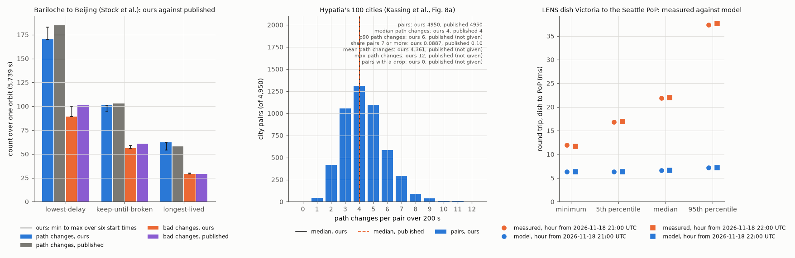

## Results: the best case

Main run, pattern `three`, re-plan every 15 s. `measures.csv`, run `main-best-case`.

| Pair | Strategy | Changes per hour (bad) | Breaks per hour | No route | A route lasts (median) | Delay (median) | Over the ideal (median, p95) | Largest drop and rise in delay |
|---|---|---|---|---|---|---|---|---|
| New York to London | `lowest-delay` | 54.5 (49.0) | 88.0 | 18.6% | 20 s | 20.7 ms | 0.0, 0.3 ms | -1.8, 1.7 ms |
| New York to London | `keep-until-broken` | 6.0 (2.5) | 75.0 | 16.3% | 25 s | 21.1 ms | 0.1, 2.9 ms | -2.9, 1.7 ms |
| New York to London | `longest-lived` | 1.5 (1.0) | 15.0 | 3.2% | 244 s | 31.5 ms | 10.6, 21.1 ms | -5.7, 0.3 ms |
| San Francisco to Tokyo | `lowest-delay` | 66.5 (63.5) | 69.5 | 15.8% | 16 s | 31.5 ms | 0.0, 0.6 ms | -2.3, 1.3 ms |
| San Francisco to Tokyo | `keep-until-broken` | 3.5 (1.0) | 65.0 | 14.6% | 34 s | 31.9 ms | 0.2, 2.0 ms | -1.4, 0.7 ms |
| San Francisco to Tokyo | `longest-lived` | 1.0 (1.0) | 18.0 | 3.8% | 206 s | 43.7 ms | 12.4, 34.4 ms | -20.6, -2.1 ms |
| Frankfurt to Singapore | `lowest-delay` | 47.0 (41.5) | 65.0 | 13.7% | 25 s | 37.8 ms | 0.0, 0.2 ms | -1.3, 0.2 ms |
| Frankfurt to Singapore | `keep-until-broken` | 6.0 (1.0) | 82.5 | 18.1% | 28 s | 38.0 ms | 0.0, 0.9 ms | -1.6, 0.2 ms |
| Frankfurt to Singapore | `longest-lived` | 1.0 (0.5) | 20.5 | 4.2% | 162 s | 42.1 ms | 4.1, 13.4 ms | -5.7, 3.8 ms |
| Detroit to Buenos Aires | `lowest-delay` | 31.0 (29.0) | 33.0 | 6.4% | 31 s | 35.4 ms | 0.0, 0.4 ms | -16.6, 5.1 ms |
| Detroit to Buenos Aires | `keep-until-broken` | 1.5 (1.0) | 42.0 | 8.1% | 58 s | 36.5 ms | 0.0, 6.3 ms | -6.9, 1.5 ms |
| Detroit to Buenos Aires | `longest-lived` | 2.0 (1.0) | 26.0 | 5.3% | 114 s | 40.9 ms | 3.7, 16.4 ms | -5.9, 17.2 ms |
| New York to Chicago | `lowest-delay` | 115.5 (112.0) | 0.0 | 0.0% | 30 s | 5.1 ms | 0.0, 0.1 ms | -0.2, 0.0 ms |
| New York to Chicago | `keep-until-broken` | 3.0 (3.0) | 41.5 | 8.3% | 76 s | 5.3 ms | 0.2, 0.8 ms | -1.1, -0.4 ms |
| New York to Chicago | `longest-lived` | 1.0 (0.0) | 22.0 | 4.5% | 127 s | 9.3 ms | 4.2, 15.1 ms | 3.3, 4.1 ms |
| Reykjavik to Vladivostok | `lowest-delay` | 38.0 (36.5) | 32.5 | 6.4% | 44 s | 29.3 ms | 0.0, 0.1 ms | -0.8, 0.2 ms |
| Reykjavik to Vladivostok | `keep-until-broken` | 3.0 (2.5) | 45.5 | 9.7% | 84 s | 29.3 ms | 0.0, 0.2 ms | -0.3, 0.0 ms |
| Reykjavik to Vladivostok | `longest-lived` | 1.5 (0.5) | 16.0 | 3.4% | 216 s | 40.3 ms | 11.1, 24.5 ms | -1.7, 12.4 ms |

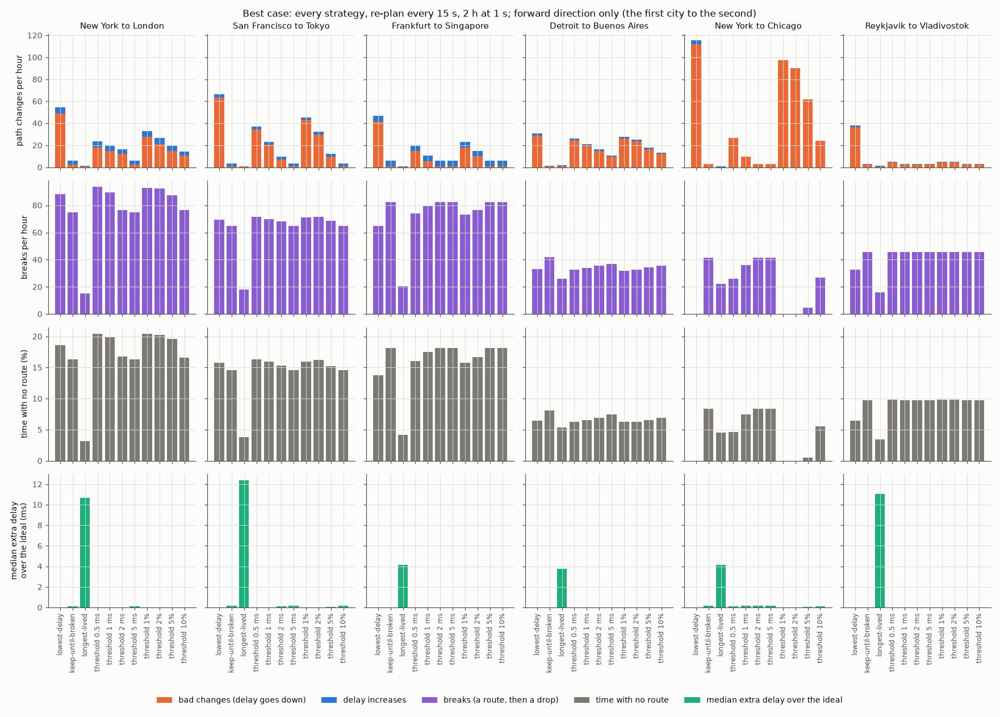

### Routes are down 6 to 19% of the time at a 15 s re-plan

With `lowest-delay`, five of the six pairs have no route for 6.4% to 18.6% of the two hours
(New York to London 18.6%, San Francisco to Tokyo 15.8%, Frankfurt to Singapore 13.7%, Detroit
to Buenos Aires and Reykjavik to Vladivostok 6.4%). Short runs made earlier in the phase gave
17 to 20%; over two hours and all six pairs the range is wider, and New York to Chicago is
never down.

- **Every one of these drops is a lost ground link** (`ground_link_lost`: the route's first or
  last satellite left the city's view). Over the three named strategies and the twelve directions the main run has
  3,028 such drop events and no other cause: no laser link of a held route went down, and no
  plan found the two cities unjoined (`drops.csv`).
- **Why: the lowest-delay route uses satellites at the edge of view.** The shortest route
  leaves the city towards the destination as flat as the mask allows. At the plans that
  replaced a route, the access satellites of `lowest-delay` sit a median 21.9° to 27.5° above
  the horizon, against a mask of 20°, and 36% to 85% of them are within 5° of the mask
  (`access_elevation.csv`; Reykjavik to Vladivostok's last satellite is the exception at a
  median 39.8°, and New York to Chicago, below). A satellite that low and moving away is gone
  within seconds, and the route then stays down until the next plan.
- **The drops start at any second of the interval.** They begin evenly over seconds 1 to 14
  after a plan (68 to 96 events at each second, `drop_offsets.csv`), never at second 0, and
  the longest lasts 14 s: the route is lost at some point in the interval and comes back at
  the next plan.
- **New York to Chicago never drops with `lowest-delay`.** Its route has no laser hop: one
  satellite sees both cities, and the lowest-delay one is high for both (median elevation
  33.3° and 38.5°, almost none within 5° of the mask).

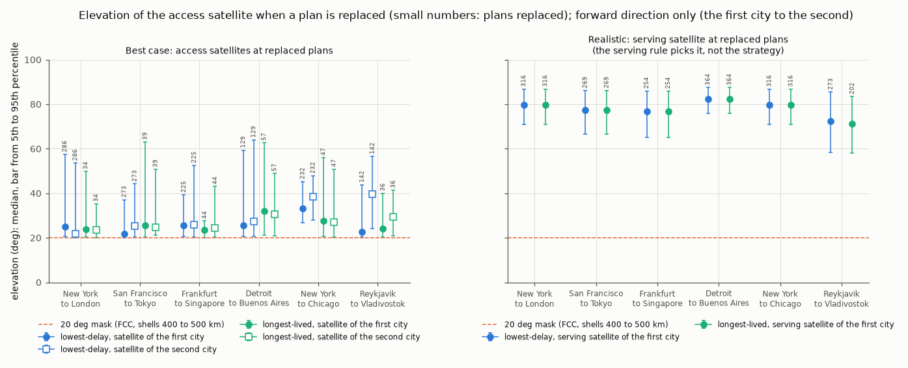

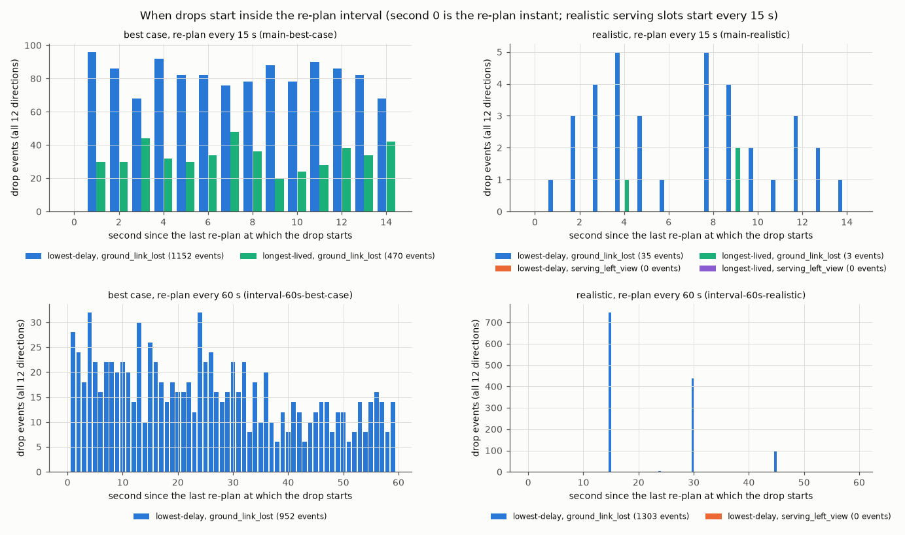

### `keep-until-broken` removes the changes, not the drops

`keep-until-broken` cuts path changes from 31 to 115 per hour down to 1.5 to 6, and bad
changes to 1 to 3 per hour. It does not cut the time without a route (8.1% to 18.1%): it
keeps a route whose access satellite is about to leave, where `lowest-delay` would sometimes
have moved to a new one. On New York to Chicago it is clearly worse, 8.3% without a route
against none. The delay it gives up is small: a median 0.0 to 0.2 ms over the ideal, 0.2 to
6.3 ms at the 95th percentile.

### `longest-lived`: few drops and few changes, at a large cost in delay

`longest-lived` picks the access satellites with the longest time left in view. The time
without a route falls to 3.2% to 5.3%, a route lasts a median 114 to 244 s instead of 16 to
44 s, and changes fall to 1 to 2 per hour. The price is delay:

| Pair | `lowest-delay` median | `longest-lived` median | More | Laser hops (median): lowest-delay, longest-lived |
|---|---|---|---|---|
| New York to London | 20.7 ms | 31.5 ms | 53% | 3, 7 |
| San Francisco to Tokyo | 31.5 ms | 43.7 ms | 39% | 6, 10 |
| Frankfurt to Singapore | 37.8 ms | 42.1 ms | 11% | 7, 11 |
| Detroit to Buenos Aires | 35.4 ms | 40.9 ms | 16% | 5, 7 |
| New York to Chicago | 5.1 ms | 9.3 ms | 81% | 0, 2 |
| Reykjavik to Vladivostok | 29.3 ms | 40.3 ms | 38% | 4, 7 |

A short run earlier in the phase gave about 75% more delay on New York to London; over two
hours it is 53%. The satellites with the longest time left are not the ones on the short way
to the destination, so the route needs more laser hops. `longest-lived` still drops 3% to 5%
of the time; why its chosen satellites are sometimes lost before the next plan was not
examined further.

### The backup path costs under 3 ms, except where the route is already long

At each plan the program also finds the best route that shares no satellite with the held
one. For `lowest-delay` the backup is a median 0.04 to 0.84 ms slower than the held route,
and 2.35 ms on Detroit to Buenos Aires; a backup existed at all 481 plans of every pair. For
`longest-lived` the backup is faster than the held route (by a median 1.5 to 12.1 ms),
because the held route was not chosen for delay.

### The threshold is a dial between the two

`threshold` keeps the held route unless the shortest path is better by more than a set
amount. Each cell: path changes per hour, share of time with no route.

| Strategy | New York to London | San Francisco to Tokyo | Frankfurt to Singapore | Detroit to Buenos Aires | New York to Chicago | Reykjavik to Vladivostok |
|---|---|---|---|---|---|---|
| `lowest-delay` | 54.5, 18.6% | 66.5, 15.8% | 47.0, 13.7% | 31.0, 6.4% | 115.5, 0.0% | 38.0, 6.4% |
| `threshold:0.5ms` | 23.5, 20.4% | 37.0, 16.3% | 20.0, 16.0% | 26.0, 6.3% | 26.5, 4.6% | 5.0, 9.8% |
| `threshold:1ms` | 20.0, 19.9% | 23.0, 16.0% | 10.5, 17.5% | 21.0, 6.5% | 9.5, 7.5% | 3.0, 9.7% |
| `threshold:2ms` | 16.5, 16.7% | 9.5, 15.3% | 6.0, 18.1% | 16.5, 6.9% | 3.0, 8.3% | 3.0, 9.7% |
| `threshold:5ms` | 6.0, 16.3% | 3.5, 14.6% | 6.0, 18.1% | 10.5, 7.5% | 3.0, 8.3% | 3.0, 9.7% |
| `threshold:1%` | 33.0, 20.4% | 45.5, 15.9% | 23.0, 15.7% | 27.5, 6.2% | 97.5, 0.0% | 5.0, 9.8% |
| `threshold:2%` | 26.5, 20.2% | 32.5, 16.2% | 15.0, 16.7% | 25.0, 6.3% | 90.0, 0.0% | 5.0, 9.8% |
| `threshold:5%` | 20.0, 19.6% | 12.0, 15.2% | 6.0, 18.1% | 18.0, 6.5% | 62.0, 0.5% | 3.0, 9.7% |
| `threshold:10%` | 14.5, 16.6% | 3.5, 14.6% | 6.0, 18.1% | 13.5, 6.9% | 24.0, 5.6% | 3.0, 9.7% |
| `keep-until-broken` | 6.0, 16.3% | 3.5, 14.6% | 6.0, 18.1% | 1.5, 8.1% | 3.0, 8.3% | 3.0, 9.7% |

A threshold of 0.5 ms already halves the changes on four pairs, which fits what Phase 2
found: most lowest-delay changes gain almost nothing. At 5 ms the strategy gives the numbers
of `keep-until-broken` on five of the six pairs. No threshold reduces the time without a route, for the
same reason as `keep-until-broken`.

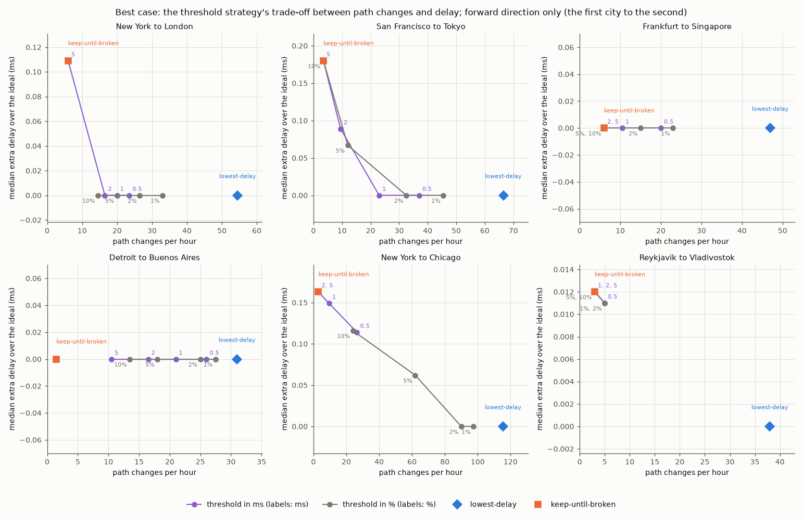

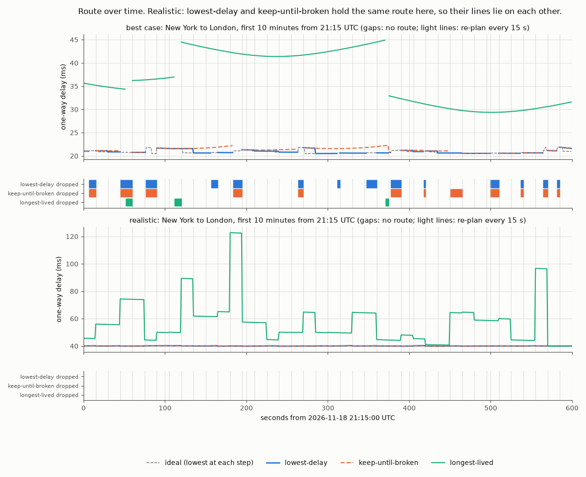

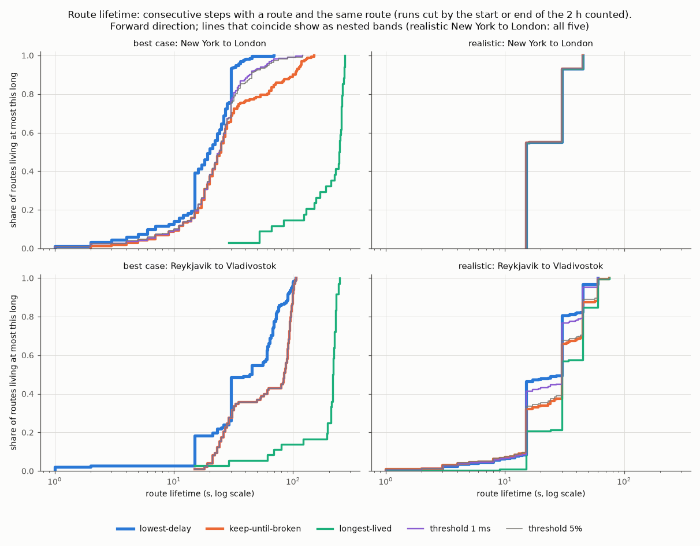

## Results: the realistic model

Main run, pattern `three`, serving rule `highest-elevation`, re-plan every 15 s.
`measures.csv`, run `main-realistic`.

| Pair | Strategy | Changes per hour (bad) | Breaks per hour | No route | A route lasts (median) | Delay (median) | Over the ideal (median, p95) | Largest drop and rise in delay |
|---|---|---|---|---|---|---|---|---|
| New York to London | `lowest-delay` | 157.5 (131.5) | 0.0 | 0.0% | 15 s | 40.1 ms | 0.0, 0.2 ms | -0.5, 0.1 ms |
| New York to London | `keep-until-broken` | 157.5 (131.5) | 0.0 | 0.0% | 15 s | 40.1 ms | 0.0, 0.2 ms | -0.5, 0.1 ms |
| New York to London | `longest-lived` | 157.5 (80.5) | 0.0 | 0.0% | 15 s | 56.7 ms | 16.7, 48.4 ms | -74.3, 67.5 ms |
| San Francisco to Tokyo | `lowest-delay` | 134.0 (93.5) | 0.0 | 0.0% | 30 s | 58.4 ms | 0.0, 0.2 ms | -0.5, 0.3 ms |
| San Francisco to Tokyo | `keep-until-broken` | 134.0 (93.5) | 0.0 | 0.0% | 30 s | 58.4 ms | 0.0, 0.2 ms | -0.5, 0.3 ms |
| San Francisco to Tokyo | `longest-lived` | 134.0 (61.0) | 0.0 | 0.0% | 30 s | 73.5 ms | 15.0, 45.6 ms | -104.3, 92.0 ms |
| Frankfurt to Singapore | `lowest-delay` | 126.5 (119.5) | 0.0 | 0.0% | 30 s | 71.0 ms | 0.0, 0.2 ms | -0.5, 0.1 ms |
| Frankfurt to Singapore | `keep-until-broken` | 126.5 (119.5) | 0.0 | 0.0% | 30 s | 71.0 ms | 0.0, 0.2 ms | -0.5, 0.1 ms |
| Frankfurt to Singapore | `longest-lived` | 126.5 (60.0) | 0.0 | 0.0% | 30 s | 94.4 ms | 23.4, 55.9 ms | -82.7, 75.9 ms |
| Detroit to Buenos Aires | `lowest-delay` | 181.5 (173.0) | 0.0 | 0.0% | 15 s | 63.4 ms | 0.3, 0.7 ms | -0.9, 0.2 ms |
| Detroit to Buenos Aires | `keep-until-broken` | 181.5 (173.0) | 0.0 | 0.0% | 15 s | 63.4 ms | 0.3, 0.7 ms | -0.9, 0.2 ms |
| Detroit to Buenos Aires | `longest-lived` | 181.5 (84.5) | 0.0 | 0.0% | 15 s | 77.6 ms | 14.6, 56.4 ms | -67.3, 71.4 ms |
| New York to Chicago | `lowest-delay` | 157.5 (131.5) | 0.0 | 0.0% | 15 s | 10.8 ms | 0.0, 0.2 ms | -0.5, 0.1 ms |
| New York to Chicago | `keep-until-broken` | 157.5 (131.5) | 0.0 | 0.0% | 15 s | 10.8 ms | 0.0, 0.2 ms | -0.5, 0.1 ms |
| New York to Chicago | `longest-lived` | 157.5 (80.5) | 0.0 | 0.0% | 15 s | 27.4 ms | 16.7, 48.4 ms | -74.3, 67.5 ms |
| Reykjavik to Vladivostok | `lowest-delay` | 118.5 (69.0) | 17.5 | 3.9% | 30 s | 86.3 ms | 21.1, 70.3 ms | -66.9, 69.7 ms |
| Reykjavik to Vladivostok | `keep-until-broken` | 91.5 (43.0) | 20.0 | 4.2% | 30 s | 88.8 ms | 23.1, 71.1 ms | -71.7, 69.7 ms |
| Reykjavik to Vladivostok | `longest-lived` | 99.0 (50.5) | 1.5 | 0.3% | 30 s | 120.7 ms | 56.1, 110.9 ms | -117.9, 139.6 ms |

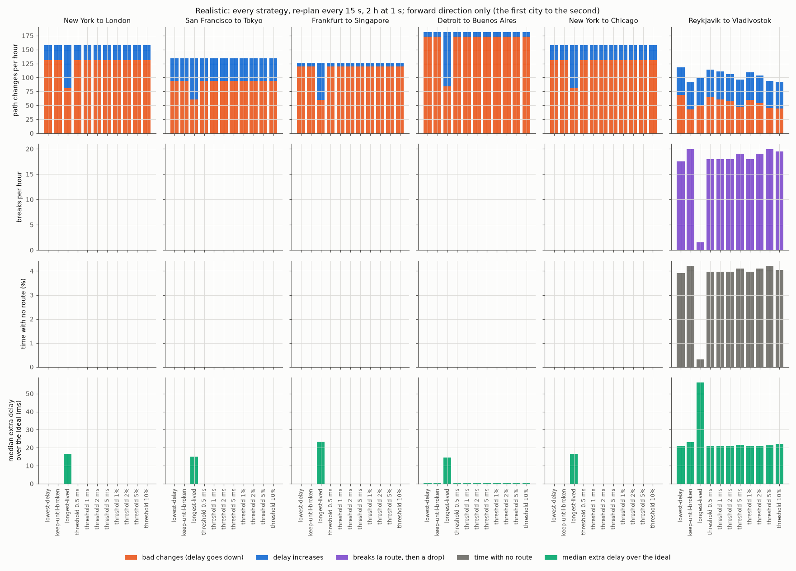

### Every strategy except `longest-lived` behaves the same

On five of the six pairs `lowest-delay`, `keep-until-broken` and all eight thresholds give
the same numbers to the last digit. The reason is in two columns of `measures.csv`:

- **The route has no laser hop.** On those five pairs the route is dish, serving satellite,
  gateway, fibre: 0 laser hops at every step. The serving satellite is the whole space part,
  so there is nothing for a strategy to choose.
- **The serving satellite changes at most slots.** With `highest-elevation` the dish takes a
  new satellite at 253 to 363 of the 480 slot changes (53% to 76%; 199, or 41%, for
  Reykjavik). Every one of those is a path change, and there are no others: 315 serving
  changes and 315 path changes for New York to London. A route lasts a median 15 to 30 s
  whatever the strategy.
- **The jumps are small:** at most 0.9 ms down and 0.3 ms up on those five pairs. But 94 to
  173 changes per hour are bad changes, about one every 20 to 40 s.
- **Nothing drops.** The highest satellite at a slot start is a median 77° to 82° up and
  never below 58° (`access_elevation.csv`), and it stays in view for its 15 s: no `serving_left_view` and no lost
  ground link on those five pairs.

Reykjavik to Vladivostok is the one pair where the strategies differ, because its route does
use lasers (a median 4 hops, up to 16) to reach a gateway. It is also the one pair that
drops: 3.9% without a route, all lost ground links.

### `longest-lived` gains nothing here and costs 9 to 23 ms

In the realistic model `longest-lived` keeps the serving satellite it is given and chooses
the satellite over the gateway by time left in view. It has as many path changes as
the others (the serving satellite still changes), and its median delay is 8.7 to 23.6 ms
higher on the ten directions that had no laser hop at all (16.6 ms on New York to London),
because it now flies a median 2 to 6 laser hops, and up to 26, to a longer-lived satellite
over the same gateway. Its changes are also far larger: delay steps of up to 104 ms down and 92 ms up on
San Francisco to Tokyo. Fewer of its changes are bad (46 to 85 per hour) only because more of
them go up.

### Reykjavik to Vladivostok and the 97° shell

Phase 2 found that the 97° shell's planes form a chain, not a ring: one gap of 46.5° in RAAN
is wider than a laser at that height can span for a whole orbit, so no link crosses it
([Phase 2 results](phase-2-results.md#the-data)). Phase 3 sees the cost on the pair that
depends on that shell. With pattern `three` the realistic route from Reykjavik is a median
21.1 ms above the ideal and 70.3 ms above it at the 95th percentile, with delay steps of up
to 70 ms; the 95th percentile of its delay is 134.8 ms, against 88.3 ms with `plus-grid` and
76.7 ms with `six`, which give a route more ways round. The highest satellite over Reykjavik
is often one from which the gateway is a long way round, and the rule does not look.

## What each setting changes

### The re-plan interval

Each cell: path changes per hour, share of time with no route. Best case:

| Run | New York to London | San Francisco to Tokyo | Frankfurt to Singapore | Detroit to Buenos Aires | New York to Chicago | Reykjavik to Vladivostok |
|---|---|---|---|---|---|---|
| 1 s, `lowest-delay` | 198.5, 0.0% | 188.0, 0.0% | 137.0, 0.0% | 76.0, 0.0% | 138.5, 0.0% | 88.0, 0.0% |
| 1 s, `keep-until-broken` | 84.5, 0.0% | 75.0, 0.0% | 97.5, 0.0% | 48.5, 0.0% | 49.5, 0.0% | 51.0, 0.0% |
| 15 s, `lowest-delay` | 54.5, 18.6% | 66.5, 15.8% | 47.0, 13.7% | 31.0, 6.4% | 115.5, 0.0% | 38.0, 6.4% |
| 15 s, `keep-until-broken` | 6.0, 16.3% | 3.5, 14.6% | 6.0, 18.1% | 1.5, 8.1% | 3.0, 8.3% | 3.0, 9.7% |
| 60 s, `lowest-delay` | 5.5, 63.7% | 10.0, 50.0% | 5.0, 51.1% | 10.0, 24.1% | 42.5, 5.8% | 10.0, 32.8% |
| 60 s, `keep-until-broken` | 0.0, 61.0% | 0.0, 50.3% | 0.5, 53.1% | 1.0, 27.7% | 0.0, 30.8% | 0.5, 34.2% |

Realistic, `lowest-delay`:

| Run | New York to London | San Francisco to Tokyo | Frankfurt to Singapore | Detroit to Buenos Aires | New York to Chicago | Reykjavik to Vladivostok |
|---|---|---|---|---|---|---|
| 1 s | 157.5, 0.0% | 141.0, 0.0% | 126.5, 0.0% | 181.5, 0.0% | 157.5, 0.0% | 158.5, 0.0% |
| 15 s | 157.5, 0.0% | 134.0, 0.0% | 126.5, 0.0% | 181.5, 0.0% | 157.5, 0.0% | 118.5, 3.9% |
| 60 s | 0.0, 66.0% | 0.5, 60.6% | 0.0, 60.4% | 0.0, 65.8% | 0.0, 66.0% | 3.0, 56.9% |

- **Re-planned every second, no route ever drops,** in either model: a route is replaced
  before its satellite leaves. The price in the best case is 76 to 199 path changes per hour
  with `lowest-delay`, the figure Phase 2 measured (191 for New York to London there, 198.5
  here over a different two hours).
- **At 60 s the route is down up to two thirds of the time** (best case 5.8% to 63.7%,
  realistic 56.9% to 66.0%). In the best case the
  access satellites leave long before the next plan (drops of up to 59 s). In the realistic
  model the cause is the slot: the dish gets a new satellite every 15 s, the held route still
  names the old one, and it stays broken until the next plan. The drops start exactly at
  seconds 15, 30 and 45 after a plan (747, 439 and 100 events; 17 at any other second), and
  the route is up 34% to 43% of the time. The few path changes at 60 s are not calm: there is
  rarely a route to change.
- **A plan interval longer than the serving slot does not work,** and one equal to it works
  in the realistic model only because the two are in step.

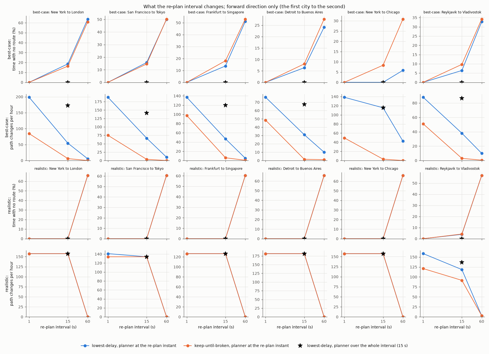

### The planner

The `whole-interval` planner uses only the links predicted to last until the next plan.

| Planner (best case, `lowest-delay`, 15 s) | Changes per hour, no route: New York to London | San Francisco to Tokyo | Frankfurt to Singapore | Detroit to Buenos Aires | New York to Chicago | Reykjavik to Vladivostok |
|---|---|---|---|---|---|---|
| `start` | 54.5, 18.6% | 66.5, 15.8% | 47.0, 13.7% | 31.0, 6.4% | 115.5, 0.0% | 38.0, 6.4% |
| `whole-interval` | 172.5, 0.0% | 141.0, 0.0% | 119.5, 0.0% | 67.5, 0.0% | 115.5, 0.0% | 86.5, 0.0% |

- **It removes every best-case drop,** on every pair, and the realistic drops of Reykjavik to
  Vladivostok too (3.9% to 0.0%).
- **It costs almost no delay:** the median one-way delay rises by 0.00 to 0.22 ms (20.67 to
  20.77 ms for New York to London), and the 95th percentile of the extra delay over the ideal
  stays under 2.6 ms.
- **It has more path changes** on the five pairs that dropped (68 to 173 per hour against 31
  to 67), because a route that would have dropped is now replaced in time, and each
  replacement is a change.

So the drops of the main run come from planning on one instant, not from the 15 s interval
itself.

### The serving-satellite rule (realistic)

Each cell: changes of serving satellite in two hours (of 480); path changes per hour; share of
time with no route; median delay.

| Rule, strategy | New York to London | San Francisco to Tokyo | Frankfurt to Singapore | Detroit to Buenos Aires | New York to Chicago | Reykjavik to Vladivostok |
|---|---|---|---|---|---|---|
| `highest-elevation`, `lowest-delay` | 315; 157.5; 0.0%; 40.1 | 268; 134.0; 0.0%; 58.4 | 253; 126.5; 0.0%; 71.0 | 363; 181.5; 0.0%; 63.4 | 315; 157.5; 0.0%; 10.8 | 199; 118.5; 3.9%; 86.3 |
| `highest-elevation`, `longest-lived` | 315; 157.5; 0.0%; 56.7 | 268; 134.0; 0.0%; 73.5 | 253; 126.5; 0.0%; 94.4 | 363; 181.5; 0.0%; 77.6 | 315; 157.5; 0.0%; 27.4 | 199; 99.0; 0.3%; 120.7 |
| `longest-in-view`, `lowest-delay` | 433; 216.5; 0.0%; 44.0 | 342; 206.0; 0.1%; 62.3 | 420; 210.0; 0.0%; 74.7 | 419; 209.5; 0.0%; 65.7 | 433; 216.5; 0.0%; 14.8 | 287; 143.5; 3.6%; 88.2 |
| `longest-in-view`, `longest-lived` | 433; 216.5; 0.0%; 44.0 | 342; 171.0; 0.0%; 62.5 | 420; 210.0; 0.0%; 74.7 | 419; 209.5; 0.0%; 82.2 | 433; 216.5; 0.0%; 14.8 | 287; 141.5; 0.7%; 96.4 |
| `highest-whole-slot`, `lowest-delay` | 315; 157.5; 0.0%; 40.1 | 268; 134.0; 0.0%; 58.4 | 253; 126.5; 0.0%; 71.0 | 363; 181.5; 0.0%; 63.4 | 315; 157.5; 0.0%; 10.8 | 199; 118.5; 3.9%; 86.3 |
| `with-route`, `lowest-delay` | 258; 129.0; 0.0%; 40.1 | 236; 120.0; 0.0%; 58.4 | 253; 126.5; 0.0%; 71.0 | 284; 142.0; 0.0%; 63.1 | 258; 129.0; 0.0%; 10.8 | 215; 54.5; 13.2%; 65.2 |
| `with-route`, `keep-until-broken` | 46; 3.0; 4.8%; 41.5 | 47; 1.5; 4.4%; 59.8 | 47; 3.5; 4.1%; 72.4 | 56; 2.5; 5.1%; 64.0 | 46; 3.0; 4.8%; 12.3 | 102; 2.5; 10.0%; 66.1 |
| `with-route`, `longest-lived` | 36; 1.5; 3.4%; 41.5 | 48; 1.0; 3.9%; 60.0 | 43; 0.5; 3.9%; 72.7 | 51; 0.5; 5.0%; 64.7 | 36; 1.5; 3.4%; 12.2 | 37; 1.5; 3.7%; 70.6 |

- **`highest-whole-slot` is `highest-elevation`,** to the last digit: the highest satellite
  never leaves view within its slot, so the extra condition never applies.
- **`longest-in-view` is worse on every count.** It changes satellite more often (287 to 433
  of 480 slots), not less, and adds 1.9 to 3.9 ms of delay. The likely reason, not checked
  further: the rule has no memory, and at each slot the satellite with the most time left is
  one that has just risen, so the dish moves to it and leaves a satellite that was still good
  for minutes.
- **`with-route` is the only rule that lets a strategy matter.** The dish takes the first
  satellite of the route its strategy would choose. With `keep-until-broken` or
  `longest-lived` the serving satellite then changes 36 to 56 times in two hours instead of
  253 to 363, and path changes fall from over 125 per hour to 0.5 to 3.5, for 0.6 to 1.8 ms
  more delay (the five pairs with no laser hop). The cost is drops: 3.4% to 5.1% of the time
  without a route, mostly `serving_left_view`, because a satellite held for minutes does fall below the mask inside a
  slot.
- **`with-route` also fixes Reykjavik to Vladivostok's delay** (median 65.2 ms with
  `lowest-delay`, against 86.3 ms and an ideal of 64.9 ms), since it is the one rule that
  checks whether the satellite can reach a gateway. It then drops 13.2% of the time.

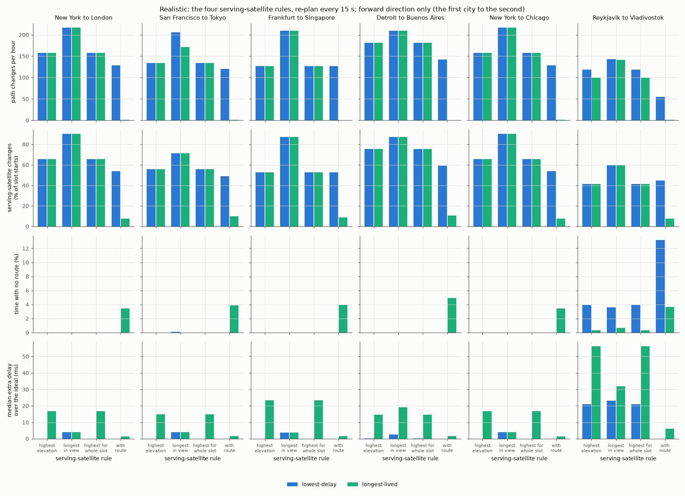

### The laser pattern

`lowest-delay`, 15 s. Each cell: median and 95th-percentile delay; path changes per hour;
share of time with no route. Best case:

| Pattern | New York to London | San Francisco to Tokyo | Frankfurt to Singapore | Detroit to Buenos Aires | New York to Chicago | Reykjavik to Vladivostok |
|---|---|---|---|---|---|---|
| `three` | 20.7, 21.9; 54.5; 18.6% | 31.5, 32.5; 66.5; 15.8% | 37.8, 38.7; 47.0; 13.7% | 35.4, 47.0; 31.0; 6.4% | 5.1, 5.2; 115.5; 0.0% | 29.3, 29.5; 38.0; 6.4% |
| `plus-grid` | 20.7, 21.2; 46.5; 16.5% | 30.8, 31.4; 67.5; 16.8% | 37.8, 38.5; 50.5; 23.1% | 35.4, 37.9; 42.0; 8.0% | 5.1, 5.2; 115.5; 0.0% | 29.2, 29.3; 78.0; 12.3% |
| `six` | 20.7, 21.1; 46.5; 16.2% | 30.7, 30.9; 75.5; 19.9% | 37.8, 38.5; 53.0; 25.9% | 33.4, 35.5; 56.5; 8.3% | 5.1, 5.2; 115.5; 0.0% | 29.1, 29.3; 78.5; 12.6% |

- **More lasers barely move the median** (under 1 ms, except Detroit to Buenos Aires with
  `six`, 2.0 ms lower) but cut the long tail: Detroit to Buenos Aires' 95th percentile falls
  from 47.0 ms to 37.9 and 35.5 ms.
- **More lasers do not reduce the drops; on four pairs they increase them** (Frankfurt to
  Singapore 13.7% to 23.1% and 25.9%, Reykjavik to Vladivostok 6.4% to 12.3% and 12.6%). The
  drops are lost ground links, which more lasers do not prevent. Why they become more
  frequent was not examined further.
- **In the realistic model the pattern changes nothing on five pairs** (no laser hop), and on
  Reykjavik to Vladivostok it lowers the median delay from 86.3 ms to 77.9 and 71.3 ms.

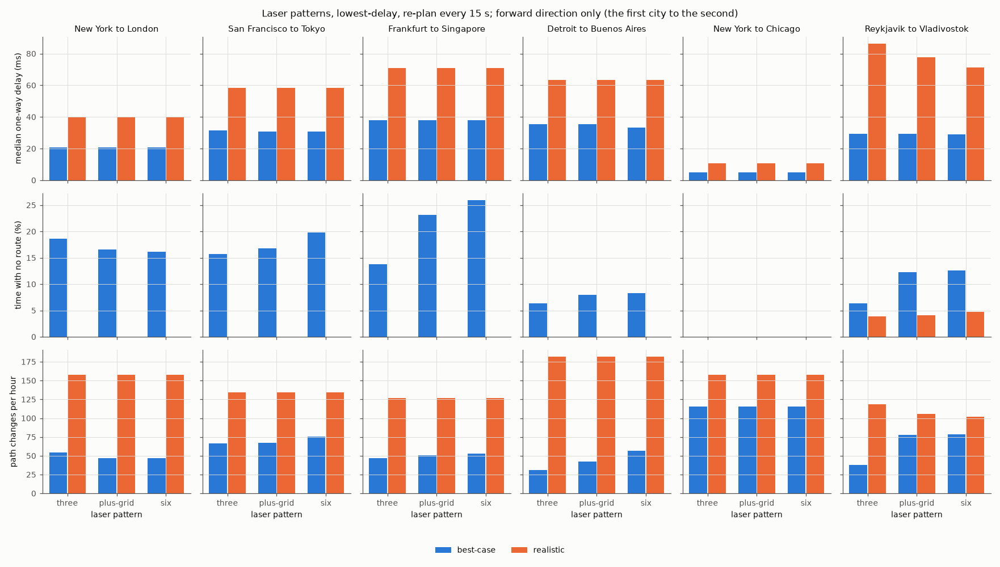

## Assumptions and simplifications, and what they cost

- **A route is a path and its delay.** No traffic, queues, packets or TCP. Bad changes are
  counted; what they do to throughput is not simulated.
- **The planner knows the orbits exactly.** Its predictions are the same SGP4 positions the
  run uses, so `whole-interval` is never wrong. A real planner's predictions are slightly off.
- **The time without a route is likely pessimistic.** When a route's satellite leaves view,
  the model waits for the next plan. A network that reacts between plans would recover
  sooner; reacting to what was not planned is Phase 4.
- **The serving slot starts at the run's start, on the minute.** Real dishes change at
  seconds 12, 27, 42 and 57 (the LENS logs above). Only the phase differs; the 15 s length is
  the measured one.
- **`highest-elevation` is the main serving rule.** Measurements show Starlink prefers high
  satellites, but not strictly; the three other rules bracket it.
- **Lasers keep the neighbours chosen at the start,** as in Phase 2.
- **Outside the US, gateways are assumed at PoP sites** (Phase 2), which decides the realistic
  routes of Frankfurt and Reykjavik here.

## Known limits

- **One two-hour window.** Phase 2 ran 12 hours; these runs cover the first two. The counts
  per hour rest on 7,200 s, so a rate of 0.5 per hour is one event.
- **Every count is a lower bound.** Events between two 1 s steps are not seen; Hypatia found
  that 1 s steps miss changes for 6% of pairs.
- **Six pairs.** The numbers describe these pairs, not the network. New York to Chicago shows
  how different a pair with no laser hop is.
- **The elevation figures are computed in Python** from the `propagate` program's positions,
  not printed by the routing program; the script checks that each is at or above its mask.
- **The Bariloche reproduction is within 8.1%, not exact,** and the paper's missing settings
  cannot be recovered.
- **The LENS comparison uses one dish and two hours,** and the dish's position is known only
  to its city.
- **Vladivostok has no home PoP,** so one of the twelve realistic directions has no service
  at all, as in Phase 2.

## Reproducing every number

Inside the CI image (`docker/Dockerfile`), from the repository root:

```sh
cmake --preset valgrind -B build/validate -DSATSIM_BUILD_TESTS=OFF
cmake --build build/validate --target routing propagate constellation

# The 15 runs, the recount and the summaries (about 30 minutes with 3 runs at a time):
python3 python/run_phase3.py --routing build/validate/bin/routing \
    --propagate build/validate/bin/propagate

# The plots:
python3 python/plot_phase3.py

# The published reproductions and the dish logs (by hand; see each script's docstring):
python3 python/reproduce_routing.py --routing build/validate/bin/routing hypatia
python3 python/reproduce_routing.py --routing build/validate/bin/routing bariloche
python3 python/fetch_lens.py
python3 python/compare_lens.py --routing build/validate/bin/routing
```

The run outputs go to `results/phase-3/` (not committed, about 60 MB compressed); the
summaries to `docs/phase-3-data/`:

| File | What it holds |
|---|---|
| `runs.csv` | One row per run: settings, exit status, every check count, laser links and link-steps |
| `measures.csv` | Per run, direction and strategy: every measure of spec 4.7 |
| `drops.csv` | Per run, direction, strategy and cause: drop events and seconds |
| `drop_offsets.csv` | Drop events by the second since the last plan at which they start |
| `access_elevation.csv` | Elevation of the access satellites at the plans that replaced a route |
| `hypatia_path_changes.csv`, `bariloche_beijing.csv` | The two published reproductions |
| `lens_victoria.csv` | The dish logs against the model |
