# Phase 4 results: failures

This report says what Phase 4 built, how it was checked, and what happens to a route when a
satellite, a laser link or a gateway stops without warning. It uses the terms defined in
[the Phase 4 spec](phase-4-failures.md) and in the specs of Phases 1 to 3. All results come
from the element-set snapshot `data/starlink/2026-11-18/` and the ground data
`data/ground/2026-11-19/`, with the laser plan made at 2026-11-18 21:15:00 UTC, 1 s steps, a
15 s re-plan, the `three` laser pattern and the `lowest-delay` strategy. Every number in this
report was measured by the commands in [Reproducing every number](#reproducing-every-number);
the summaries behind the tables are committed in `docs/phase-4-data/`.

Words used all through:

- **Best case** and **realistic:** the two endpoint models of Phase 2 (dishes at both cities
  and space only; or one serving satellite per 15 s slot, a gateway and fibre).
- **Failure:** an element (a satellite, a laser link or a gateway) that stops at an instant
  nobody predicted. **Permanent** for the rest of the run, or **transient** (it comes back).
- **The truth** and **a view:** what is really working, and what one actor (the planner, a
  satellite, a dish) believes is working. After a failure they differ until the news arrives.
- **Reaction mode:** who reacts. `planner`: a planner on the ground learns of the failure
  from reports and gives new routes at its next plan. `local-repair`: the same planner, and
  the node next to the dead element switches at once to a backup path it already holds.
  `flooding`: every satellite tells its neighbours, and each works out its own next hop.
- **Black hole:** traffic sent into a dead element by a node that does not know yet.
  **Loop:** traffic passed round in a circle by nodes with different views.
- **Lost time:** the seconds a direction has no working route while the same run without the
  failure (the **baseline**) had one. **Restore:** from the failure to the first instant
  traffic gets through again. **Settle:** from the failure to the instant the route becomes
  the one a planner with full knowledge holds, and stays it.
- **Re-pointing:** a laser freed by a failure finds a new partner; the new link (a **repair
  link**) works after an **acquisition time**.
- **After recovery:** the network once everybody knows about every failure.

## Headline results

1. **Who reacts decides how long traffic is lost.** One dead satellite on a route costs the
   `planner` a median of 8.5 s (1 s to 15 s: exactly the wait for the next plan),
   `local-repair` 0.1 s (the detection time) and `flooding` 0.2 s (detection plus the time to
   work out a new table). This holds in both endpoint models.
2. **Flooding buys that with messages.** One dead satellite takes a median of 6 report hops
   to reach the planner and about 144,000 message sendings to flood the constellation. A
   failed region takes 342 hops against 6.6 million sendings.
3. **Local repair fails when the backup is dead too.** With a whole region failed (a median
   of 69 satellites), `local-repair` in the best case loses a median of 8 s, as much as the
   planner, while `flooding` still loses 0.21 s.
4. **Loops are real but short.** `flooding` loops for at most 0.046 s in any run. `planner`
   and `local-repair` never loop.
5. **Telling the planner to re-plan as soon as a report arrives** brings it to 0.10 s in the
   best case, level with local repair. In the realistic model it does not help the median
   (8 s), because the dish keeps its serving satellite until its slot ends.
6. **The network survives large random losses.** With 10% of the satellites failed at
   random, every one of 4,950 city pairs still has a route and the median extra delay is
   0.03 ms. At 30% failed, 94% of the pairs have a route. Failing the 30% busiest satellites
   instead leaves 76%.
7. **Re-pointing mends what is left.** With freed lasers re-pointed, 30% random losses leave
   99.999% of the pairs connected instead of 94%, and the extra delay falls from 2.7 ms to
   0.25 ms.
8. **Two published results, compared but not reproduced.** StarGlider reports that 7% of
   backup paths are more than 20% slower than the best path; ours are 20% (+Grid) and 47%
   (`three`), under a different way of picking backups. The share of failures at which a
   shell falls apart agrees with percolation theory to within one 5% step for satellites and
   laser links on both link sets.

## What was built

- **`failure` module:** the failure schedule and its file, what is down at an instant, and
  who can detect a failure from the laser plan.
- **`network` and `routing` additions:** shortest delays from several sources, the tree of
  shortest paths towards a target, connected pieces; forwarding tables and the hop-by-hop
  walk that finds a delivery, a dead end or a loop.
- **`topology` additions:** re-matching freed lasers (in-plane bridging across a dead
  satellite, then cross-plane), one fixed list of links for a run with each link's status
  over time, and the checks for them.
- **The `failures` program:** steps a failure schedule through continuous time on each
  step's frozen geometry. It carries five lanes side by side: the baseline (no failure), the
  reference (a planner that knows everything), and the three reaction modes. It writes every
  interval of every direction (state, route, delay, the failed element), every fact and who
  learnt it when, the measures, and its own checks.
- **The Phase 3 engine, split into truth and view.** Planning uses a view, delivery is judged
  against the truth. With no failure the two are the same and `routing`'s output is byte for
  byte what it was before Phase 4.
- **An independent Python model** (`python/validate_failures.py`), written from the spec
  without reading the C++, and the `validate-failures` CI step that compares the two.
- **The runners and plots:** `python/make_failures.py`, `python/run_phase4.py`,
  `python/compare_failures.py`, `python/plot_phase4.py`.

## The runs

**Hand-picked failures.** Each run carries one city pair one way, starts at the last re-plan
instant at least 60 s before the failure and ends 300 s after it. The failure instants are
T_i = 21:15:00 + 300 s + i × 697 s, so that the failure falls at ten different offsets after a
re-plan. The six study pairs are those of Phase 3: New York to London, New York to Chicago,
San Francisco to Tokyo, Frankfurt to Singapore, Detroit to Buenos Aires, Reykjavik to
Vladivostok.

| Scenario | What fails |
|---|---|
| `route-satellite` | The middle satellite of the baseline route |
| `route-laser` | The middle laser link of the baseline route |
| `access-satellite` | The first satellite of the route |
| `plane` | Every satellite in the middle satellite's plane (14 to 51 satellites, median 29) |
| `region` | Every satellite within 1,000 km of the middle satellite's ground point (33 to 100, median 69) |
| `gateway` | The gateway the route uses (realistic only) |

| Group | Runs | What varies |
|---|---|---|
| Main | 600 | Every scenario, both models, six pairs, ten instants |
| Gateway | 60 | The gateway scenario, ten instants |
| Transient | 144 | Failures lasting 10 s and 60 s |
| Detection | 216 | Detection time 0.01 s, 1 s and 40 s (default 0.1 s) |
| Compute | 240 | Compute time 0.01 s (default 0.1 s), `flooding` |
| Planner | 470 | Re-planning on a report; the `start` planner |
| Re-pointing | 576 | Re-pointing on, acquisition 2, 12, 30 and 100 s |

The main and gateway groups use all ten instants. The other groups use the first four: the
full plan of ten took too long to run (the owner's decision 8, as changed on 2026-11-22).

312 planned scenarios could not be run and are listed in `scenarios.csv` with the reason: 252
because the baseline route has a single satellite and so no laser hop to fail (most
`route-laser` cases in the realistic model, where 50 of 60 are skipped), and 10 because the
baseline had no route at the failure instant.

**After recovery.** One step at T_0, best case, Hypatia's 100 cities (4,950 pairs), every
failure dated an hour earlier so that everyone knows it. 1,020 runs: 0.1% to 30% of the
satellites or of the laser links failed at random (30 seeds each), the busiest satellites
failed first (the "attack", at each of the ten instants), both again with re-pointing, and
random satellite failures again with the `plus-grid` and `six` patterns.

All 3,326 runs ended with exit status 0 and zero failed checks.

## How it is shown to be right

### 1. Checked in every run

The program counts violations of physical and logical rules as it runs and exits non-zero on
any. Besides the checks of Phases 2 and 3 it checks: a delivered route has every hop up in
the truth; a black hole is on an element that is really down; no actor uses a fact before it
can know it; no repair happens before detection; once settled, every mode holds the reference
route; with re-pointing off no delay is below the baseline's ideal; a loop passes a node
twice; no table uses a fact early; a finished flood reached every node it could; settled
tables agree with the settled route. The sum over the 3,326 runs is 0.

Two of these checks found faults in the realistic model during the runs, each fixed with a
failing test first: local repairs must come before a plan made on a report at the same
instant, and a `flooding` dish must not be able to avoid a dead satellite it has no way of
knowing about.

### 2. Counted twice

`python/run_phase4.py` recounts every measure of every lane from the events CSV and compares
it with the program's own measures: 3,326 runs, 0 differences.

### 3. Agrees with Phase 3

With no failure file, `failures` gives the rows `routing` gives, in both models on the real
snapshot (a check executable), and a `flooding` lane with no failure gives the
`lowest-delay` rows. `routing`'s own output is byte-identical to before Phase 4.

### 4. Agrees with an independent model (the `validate-failures` CI step)

On Hypatia's 1,584-satellite shell the program and the Python model agree on every interval
(start and end to 1e-9 s, delay to 1e-9 ms), every fact and who detected it when, every
node's learning instant in every flood, every route row, every measure and every network row,
in six cases: satellite and laser-link failures, permanent, transient and old news, all three
reaction modes, two strategies, two planners, re-planning on a report, re-pointing with
in-plane and cross-plane repair links, and a +Grid and a `three` link file
([docs/ci.md](ci.md#the-validate-failures-step)). Four errors planted in the C++ one at a
time each made the step fail.

The model covers the best case only. The realistic model and gateway loss rest on the unit
tests, the in-run checks and the recount.

### 5. Compared with published results (reported, never pass or fail)

**StarGlider's backup cost.** [StarGlider](https://arxiv.org/html/2401.11490) reports that
7% of its precomputed backup paths are more than 20% slower than the best path. Drawing
1,000 random pairs and failures on Hypatia's shell, the share of our local-repair backups
more than 20% slower is 20.0% with the +Grid and 46.8% with `three` (median ratio 1.05 and
1.19). Our backup is the shortest path from the repairing node that avoids the dead element,
on a shell with fewer links; StarGlider picks its backups differently. The numbers are not
expected to match, and nothing was tuned towards 7%.

**Percolation.** Theory gives the failed share at which a network stops having one large
piece. The mean largest piece first falls below one half at:

| Link set | Fails | Theory | Measured (5% steps, 20 seeds) |
|---|---|---|---|
| +Grid | satellites | 0.41 | 0.45 |
| +Grid | laser links | 0.50 | 0.55 |
| `three` | satellites | 0.30 | 0.35 |
| `three` | laser links | 0.35 | 0.35 |

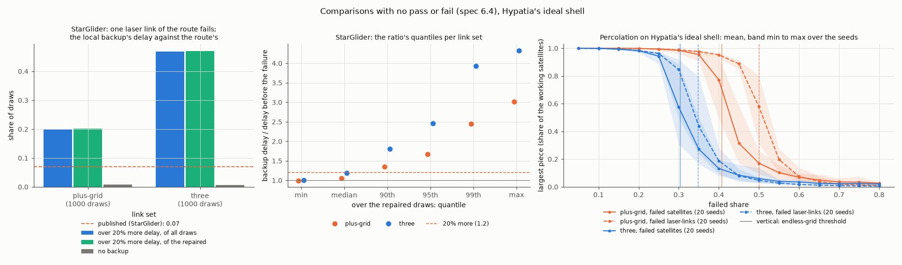

## Results: one failure, three ways of reacting

Lost time in seconds over the main group (median, and 5th to 95th percentile):

| Scenario | Model | `planner` | `local-repair` | `flooding` |
|---|---|---|---|---|
| `route-satellite` | best case | 8.5 (1 to 15) | 0.10 (0.10 to 0.10) | 0.20 (0.20 to 0.21) |
| `route-laser` | best case | 8.5 (1 to 15) | 0.10 (0.10 to 0.10) | 0.20 (0.20 to 0.21) |
| `access-satellite` | best case | 8.5 (1 to 15) | 0.10 (0.10 to 0.10) | 0.20 (0.20 to 0.20) |
| `plane` | best case | 8.5 (1 to 15) | 0.10 (0.10 to 12.1) | 0.20 (0.20 to 0.24) |
| `region` | best case | 8.5 (1 to 15) | 8.0 (0.10 to 15) | 0.21 (0.20 to 0.23) |
| `route-satellite` | realistic | 8.5 (1 to 15) | 0.10 (0.10 to 0.10) | 0.20 (0.20 to 0.20) |
| `route-laser` | realistic | 8.5 (1.5 to 13.6) | 0.10 (0.10 to 0.10) | 0.20 (0.20 to 0.21) |
| `access-satellite` | realistic | 8.5 (1 to 15) | 0.10 (0.10 to 0.10) | 0.20 (0.20 to 0.20) |
| `plane` | realistic | 9.0 (1 to 34) | 0.10 (0.10 to 9.1) | 0.40 (0.20 to 0.42) |
| `region` | realistic | 9.0 (1 to 19.6) | 0.10 (0.10 to 15.1) | 10.8 (0.23 to 16.2) |
| `gateway` | realistic | 8.5 (1 to 15) | 0.10 (0.10 to 0.10) | 0.20 (0.20 to 0.21) |

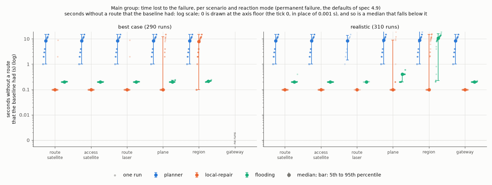

### The planner loses exactly the wait for its next plan

For a single failed element the planner's lost time is 15 s minus the seconds the failure
fell after a re-plan: 15 s for a failure at a re-plan instant, 1 s for one 14 s after it, in
all 30 runs at each offset. The first report reaches the planner within 0.03 s of detection, so the
news is there long before the plan; the plan is what it waits for.

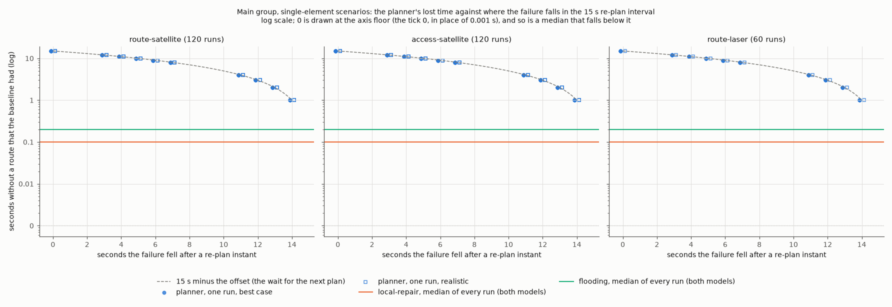

In the realistic model the planner can lose much more with a plane or a region failed: up to
75 s and 153 s, all three such runs from Reykjavik. In the longest one the planner hands
the dish one dead satellite after another for 153 s. Nobody is left to report those
satellites: their laser neighbours are dead too and no gateway sees them, so the planner
never learns they are down.

### Local repair is the detection time, when the backup works

`local-repair` loses 0.10 s in every run where the node next to the failure holds a backup
that works. It loses more in three cases: there is no backup (a best-case maximum of 9 s for
a single satellite or link), the backup passes another dead element (the `plane` and
`region` scenarios), or the planner's next plan hands it a route through an element the
planner does not yet know is dead.

The repaired route is a little longer until the next plan: the extra delay at settling has a
median of 0.01 ms and a 95th percentile of 1.9 ms for one satellite, and a median of 7.8 ms
(95th percentile 57 ms) for a region.

### Flooding is detection plus compute, and it loops briefly

`flooding` loses 0.20 s: 0.1 s to detect and 0.1 s to work out new tables. While the
news spreads, nodes that know and nodes that do not can pass traffic back and forth. The
longest loop in any run is 0.046 s; in the single-element scenarios it is under 0.01 s.

In the realistic model with a region failed, `flooding` loses a median of 10.8 s. The dish
knows only what it found out itself, so it tries the dead satellites it sees one after
another, 0.2 s each. The `local-repair` figure in the same row (0.10 s) is not comparable:
see [Known limits](#known-limits).

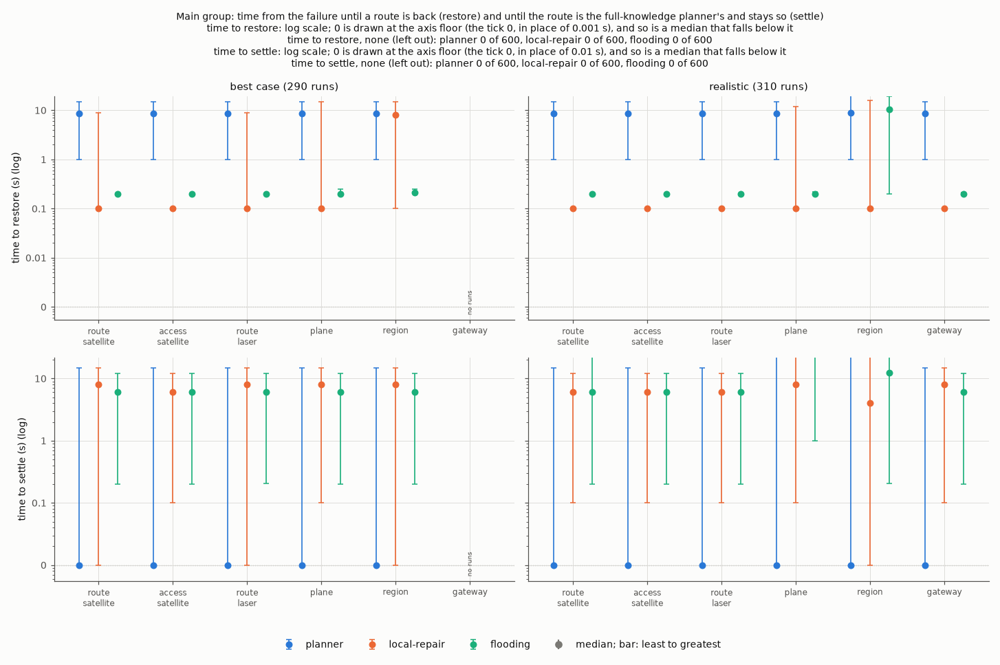

### What the messages cost

| Scenario (best case) | Report hops to the planner (median) | Flood sendings (median) |
|---|---|---|
| `route-laser` | 4 | 47,000 |
| `route-satellite` | 6 | 144,000 |
| `plane` | 66 | 1,610,000 |
| `region` | 342 | 6,600,000 |

A report travels a few hops to the nearest gateway. A flood sends every fact over every
working laser link once in each direction, so its cost grows with the number of facts times
the size of the constellation.

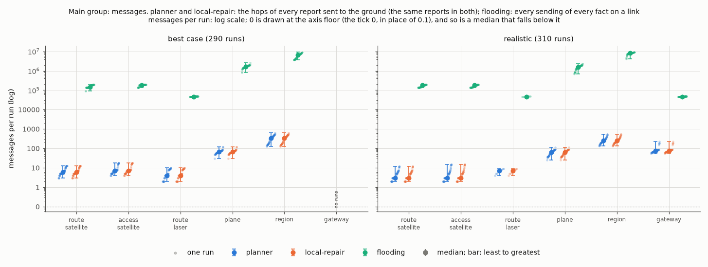

### Extra delay once the route is back

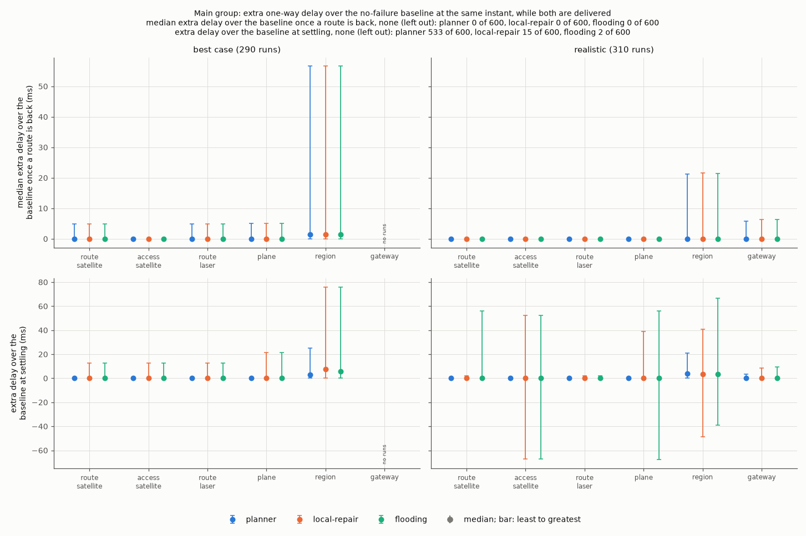

Once settled, losing one satellite or link costs a median of 0.01 to 0.12 ms and at most
12.6 ms in the best case. Losing a region costs a median of 3 to 8 ms and up to 76 ms.

## What each setting changes

### Detection time

Lost time in seconds, `route-satellite` and `route-laser`, best case, the first four
instants (median):

| Detection | `planner` | `local-repair` | `flooding` |
|---|---|---|---|
| 0.01 s | 8.5 | 0.01 | 0.11 |
| 0.1 s | 8.5 | 0.10 | 0.20 |
| 1 s | 9.0 | 1.0 | 1.1 |
| 40 s | 23.5 | 23.5 | 23.5 |

`local-repair` and `flooding` follow the detection time one for one. At 40 s (a routing
protocol's timeout, with no signal from the laser itself) every mode is the same: the
geometry or a regular plan moves the route away before anyone has detected anything.

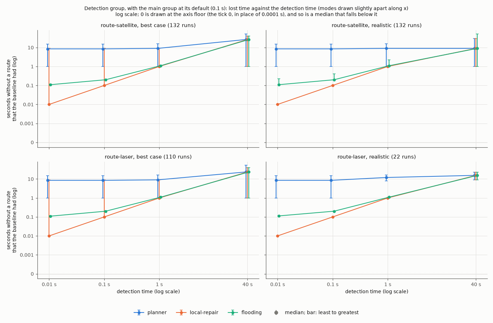

### Compute time

With 0.01 s to work out new tables instead of 0.1 s, `flooding`'s median lost time goes from
0.20 s to 0.11 s. Loops do not change (maximum 0.046 s in both): they depend on how the news
travels, not on how fast a node computes.

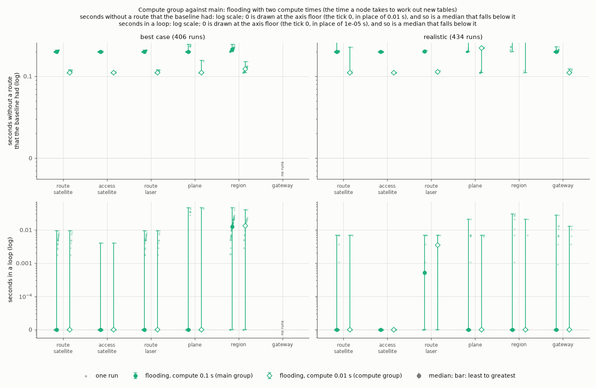

### The planner

Lost time in seconds over every scenario, the first four instants (median, 95th
percentile):

| Variant | Model | `planner` | `local-repair` |
|---|---|---|---|
| Default (`whole-interval`, plans every 15 s) | best case | 8.5, 15 | 0.10, 15 |
| Re-plan on a report | best case | 0.10, 0.12 | 0.10, 0.12 |
| `start` planner | best case | 12, 31.5 | 0.10, 31.5 |
| Default | realistic | 9.0, 15 | 0.10, 0.88 |
| Re-plan on a report | realistic | 8.0, 15 | 0.10, 0.12 |
| `start` planner | realistic | 9.0, 15 | 0.10, 9.0 |

Re-planning on a report removes the planner's wait in the best case, and also the long tail
of `local-repair` (a plan on the report replaces a dead backup). In the realistic model the
planner's median stays at 8 s: the new plan still has to use the dish's serving satellite,
and a dish under `planner` changes satellite only at a slot start. The `start` planner of
Phase 3, which plans on one instant's links, adds its own drops after a failure, up to 67 s.

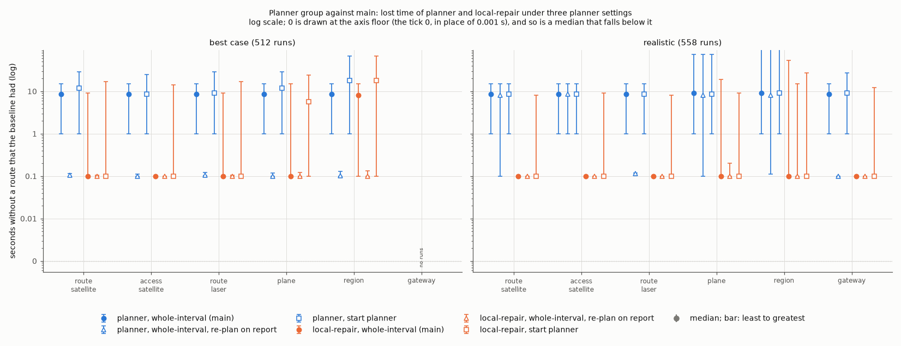

### Transient failures

A failure that ends after 10 s or 60 s costs the same lost time as a permanent one in every
mode (median 8.5 s, 0.10 s and 0.20 s): the damage is done in the first seconds. What changes
is the settle time, because the route moves a second time when the element returns: its
95th percentile for `flooding` goes from 9 s to 53 s (10 s failures) and 98 s (60 s).

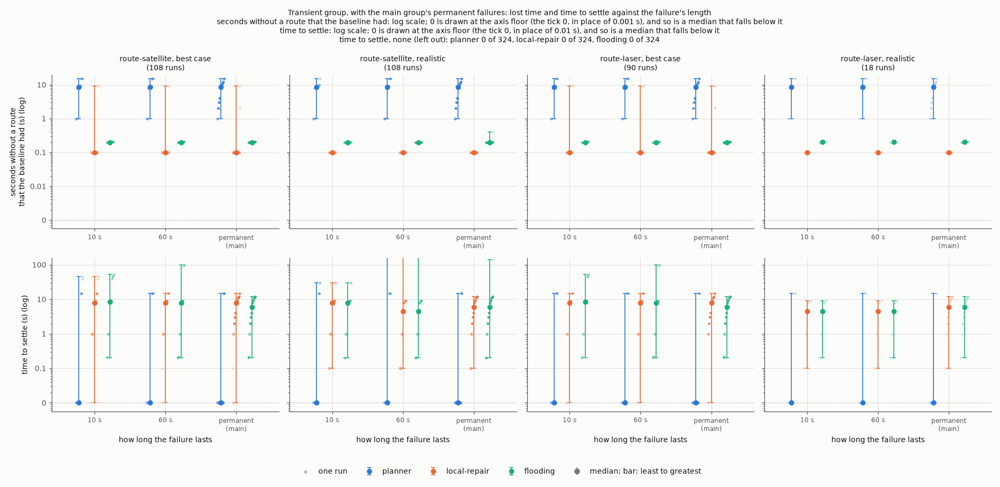

### Re-pointing

Re-pointing does not change the lost time: a repair link works only after its acquisition
time, long after every mode has moved the route. It changes the route afterwards. For a
failed region, a median of 46 repair links are made, and the planner's extra delay at
settling in the best case goes from a median of 2.95 ms with no re-pointing to about 0 with
an acquisition time of 2 s or 12 s, 2.06 ms at 30 s and 2.95 ms at 100 s: the slower the
links come up, the later they can be used, and settling is measured at the first plan that
holds the reference route. For one
failed satellite one or two repair links are made and the gain is under 0.2 ms. For a failed
plane no repair link is made: the neighbours' freed lasers find no partner in reach.

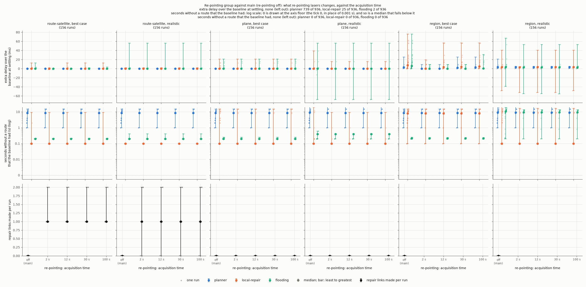

### Losing a gateway

| Gateway | Runs | Next gateway | Extra delay at settling, `local-repair` (median, max) |
|---|---|---|---|
| Real (community list) | 40 | 4 to 16 km away | 0.03 ms, 0.13 ms |
| Assumed (at a PoP) | 20 | 518 to 1,687 km away | 4.1 ms, 8.7 ms |

Lost time is as for a satellite (8.5 s, 0.10 s, 0.20 s). Where real gateways are known they
come in clusters, and losing one costs nothing measurable. The assumed gateways are one per
PoP, so the cost there is the distance to the next PoP and says more about our assumption
than about the network.

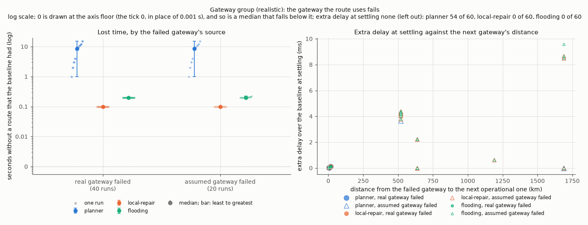

## Results: after recovery

Share of the 4,950 pairs that still have a route, and the median extra delay of those that
do (mean over the runs; 2.5th to 97.5th percentile of the runs in brackets):

| Failed | Random satellites | Random lasers | Attack | Random satellites, re-pointed | Attack, re-pointed |
|---|---|---|---|---|---|
| 0.1% to 3% | 100% | 100% | 100% | 100% | 100% |
| 10% | 100%, 0.03 ms | 100%, 0.00 ms | 100%, 3.0 ms | 100%, 0.00 ms | 100%, 1.9 ms |
| 30% | 94.4% (87.6 to 99.5), 2.7 ms | 99.6% (97.9 to 100), 1.9 ms | 76.0% (56.7 to 88.8), 45 ms | 99.999%, 0.25 ms | 89.3% (71.1 to 99.9), 40 ms |

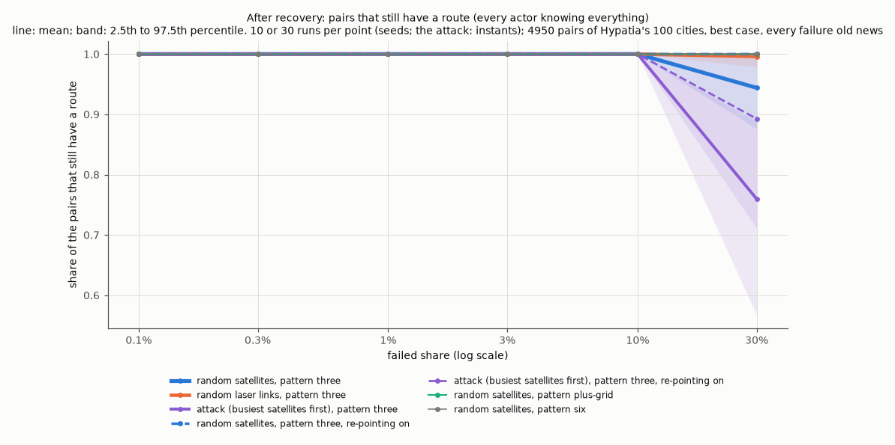

- Up to 10% failed, nothing is cut off, whatever fails and however it is chosen. The
  largest piece of each shell still holds 96% or more of its working satellites.
- At 30% the shells fall apart (the largest piece holds 20% to 45% of a shell's working
  satellites after random satellite failures), yet 94% of the pairs keep a route: a city
  sees satellites of several shells and several pieces, and the route may come down at a
  gateway and go up again.
- Taking the busiest satellites first is far worse than taking them at random at 30%, and
  costs 3 ms already at 10%.
- The pattern matters: with 30% of the satellites failed, `three` keeps 94.4% of the pairs,
  `plus-grid` 99.999% and `six` 100%, with median extra delays of 2.7, 1.9 and 1.0 ms.

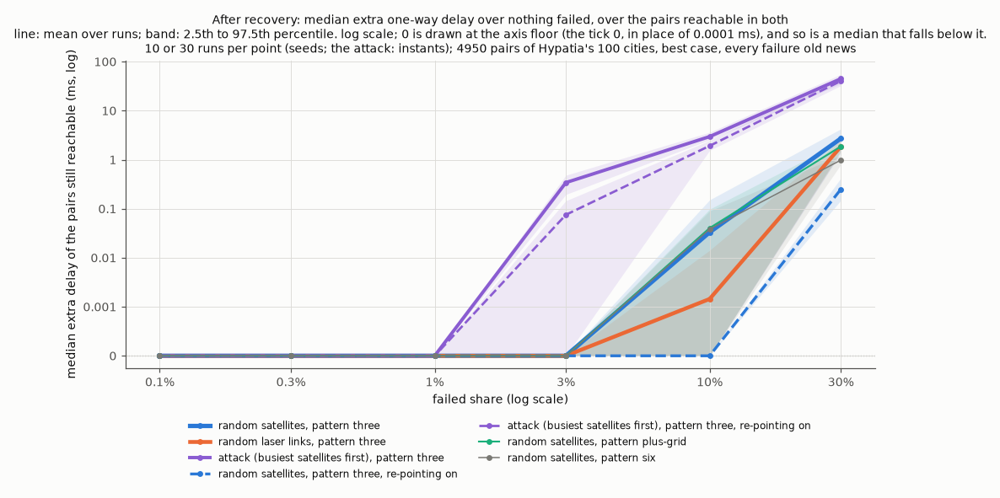
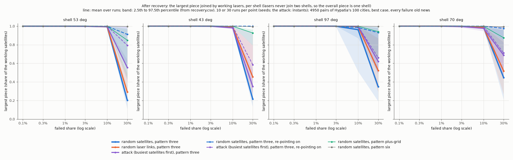

For scale: the real rate of unannounced losses is about one satellite a week across the
fleet, 0.01% of it.

## Assumptions and simplifications, and what they cost

- **The times are settings, and two are guesses.** Detection 0.1 s, 1 ms per hop to pass a
  message on, 0.1 s to work out routes. The 1 ms and the 0.1 s have no source. The sweeps
  above show that lost time follows detection and compute time one for one.
- **Each step's geometry is frozen** while the events inside it play out in continuous time.
  Satellites move about 7.6 km in a second, which changes a delay by under 0.03 ms.
- **Messages are never lost** and travel over the truth: a report or a flood takes the
  shortest working path. A real control channel has its own failures.
- **The planner's own time is zero.** It plans the instant its re-plan comes round.
- **No traffic is modelled.** A backup path or a repair link is never full, so the cost of
  crowding traffic onto fewer satellites is not in any number here.
- **Failures are scheduled by us.** The scenarios are our choice. The random and attack runs
  say what the network withstands, not what happens to it.
- **Assumed gateways** are one per PoP outside the US (Phase 2), which decides the gateway
  results above.

## Known limits

- **The `local-repair` dish is treated more kindly than the `flooding` dish.** When its
  serving satellite dies, the `local-repair` dish picks its next one among the satellites
  that really work. The `flooding` dish picks among all it sees and can land on another dead
  one. With a single failure this makes no difference. With a plane or a region failed in
  the realistic model it does: `local-repair`'s 0.10 s there is a lower bound, and
  `flooding`'s 0.40 s and 10.8 s are what a dish without outside help would see.
- **A `flooding` dish never tries again a satellite it found dead,** even after it returns.
  It has no way of learning of the return.
- **The settle time hides the planner's outage.** Settling is measured against a planner
  with full knowledge on the same 15 s schedule, so the planner's median settle time is 0 s
  while it is losing traffic: it holds no route, and neither would the reference until its
  next plan. Lost time and restore time are the measures to read for the planner.
- **The independent model covers the best case only.** No published result was reproduced:
  the two comparisons are with papers that model something else.
- **Sensitivity groups use four failure instants** and the random runs 30 seeds. At 30
  seeds, a share near one half is known to about ±18 points; the shares reported here are
  near 0 or 1 except at 30% failed, where the brackets in the table show the spread.
- **One snapshot, one two-hour window, six pairs,** as in Phase 3.

## Reproducing every number

Inside the image of `docker/Dockerfile` (or any machine with the build tools and Python
packages it installs):

```bash
cmake -S . -B build/validate -DCMAKE_BUILD_TYPE=Release -DSATSIM_BUILD_TESTS=OFF
cmake --build build/validate -j
python3 python/run_phase4.py --failures build/validate/bin/failures --jobs 4
python3 python/compare_failures.py starglider --failures build/validate/bin/failures
python3 python/compare_failures.py percolation --failures build/validate/bin/failures
python3 python/plot_phase4.py
```

`run_phase4.py` takes about two hours on 4 cores and writes the per-run files to
`results/phase-4/` (not in git) and the summaries to `docs/phase-4-data/`. `--reuse` keeps the
runs already finished. `plot_phase4.py` reads only the committed summaries.

| File | Holds |
|---|---|
| `runs.csv` | One row per run: settings, exit status, every check count |
| `scenarios.csv` | One row per planned scenario: what failed, or why it was skipped |
| `measures.csv` | One row per run and reaction mode: lost, loop, restore and settle time, extra delay, reports, messages |
| `recovery.csv`, `recovery_summary.csv` | The after-recovery runs, and their summary per failed share |
| `starglider.csv`, `percolation.csv` | The two comparisons |
