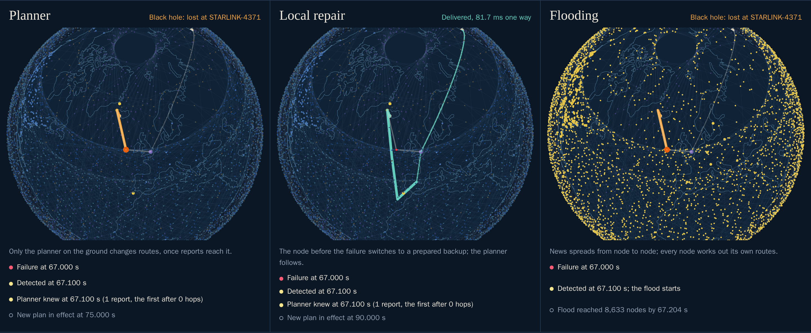
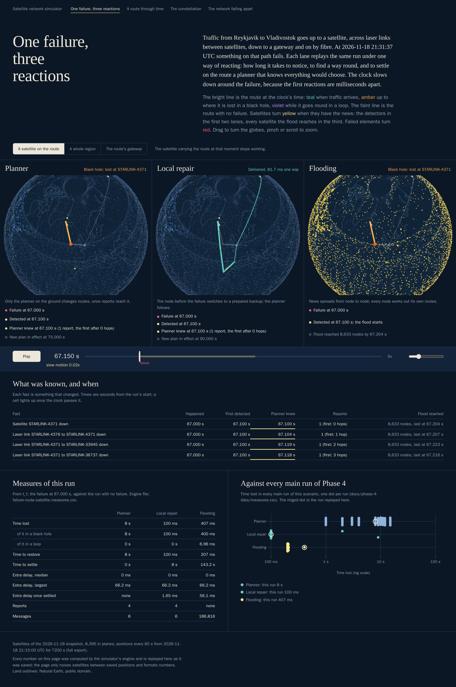
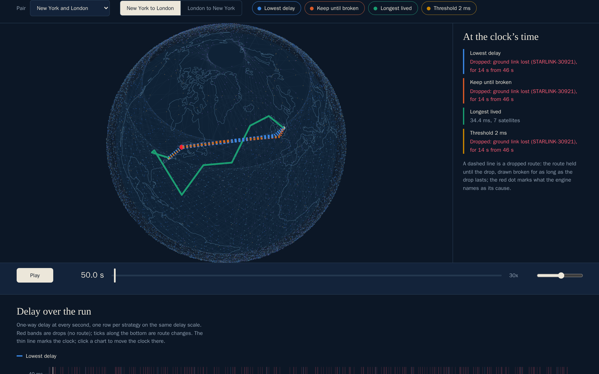
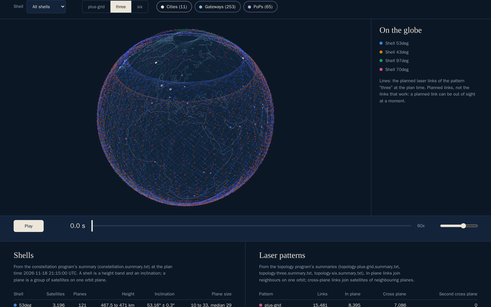
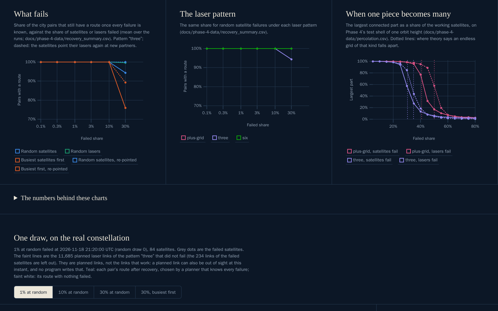

# Phase 5 results: the dashboard

What was built for [the Phase 5 spec](phase-5-dashboard.md), how it is checked, what it
weighs and what it does not do. Every number here was measured on 2026-11-22 and 2026-11-23
in a cloud session (x86-64, 4 cores) on the snapshot of 2026-11-18.

## What was built

A web page in `dashboard/` that replays runs the engine saved. Nothing is simulated in the
browser. It has four stories, each with a short text, a globe, and tables or charts:

| Story | What it replays |
|---|---|
| One failure, three reactions | One `failures` run per scenario (a satellite on the route, a region, a gateway) for Reykjavik to Vladivostok, realistic model: the planner, local repair and flooding side by side on one clock |
| A route through time | A two-hour `routing` run, best case: six city pairs, both directions, four strategies |
| The constellation | 8,395 satellites by shell and plane, the three laser patterns, cities, gateways and PoPs |
| The network falling apart | Phase 4's committed summaries as charts, and four one-step `failures` runs (1%, 10% and 30% of the satellites at random, and the busiest 30%) on the globe |











The screenshots are taken by the browser test (`SATSIM_SCREENSHOTS=1`), on the full export.

Reykjavik to Vladivostok was chosen for the failure story because, at the chosen instant, it
is the only study pair where the three modes differ in kind and not only in length: the
planner has a black hole of 8 s, local repair one of 0.1 s, and flooding a black hole of
0.4 s and a loop of 7 ms, and flooding settles after 143.2 s.

## The parts

| Part | Size | Job |
|---|---|---|
| `python/export_dashboard.py` | 1,258 lines | Runs `propagate`, `constellation`, `topology`, `routing` and `failures` on a fixed list of scenarios and writes `dashboard/public/data/` |
| `python/check_dashboard_data.py` | 1,051 lines | Reads the exported data back with code of its own and compares it with the engine's CSV files |
| `dashboard/src/`, `dashboard/e2e/` | 6,817 lines of TypeScript | The page and its tests |
| `scripts/ci.sh dashboard` | one step | Small export, data check, type check, lint, unit tests, build, browser test |
| `.github/workflows/pages.yml` | hand-started | Full export, data check, build, publish to GitHub Pages |

The engine's C++ was not changed.

## What the data weighs

| | Small export (tests) | Full export (the site) |
|---|---|---|
| Window | 7 minutes | 2 hours |
| Position samples (every 60 s) | 8 | 121 |
| Files | 10 | 10 |
| Total | 2,073,538 bytes | 20,567,793 bytes (19.6 MiB) |
| Largest file | `positions-0.bin`, 805,920 bytes | `positions-0.bin`, 12,189,540 bytes |
| Export time | 31 s | 4 min 42 s (the two-hour routing run is 232 s of it) |
| Data check time | 17 s | 37 s |

Every file is under 25 MiB, so the site fits Cloudflare Pages' free plan as well as GitHub
Pages. The page itself, without data, is 796 kB on disk (the script is 784 kB, 221 kB
compressed; most of it is three.js).

## How it is shown to be right

**The data check finds 0 differences** on both exports. It compares the manifest with the
files on disk, every satellite's shell and plane, every position sample, every laser link of
the three patterns, and every interval, state, route, delay, drop, fact, flood instant and
measure of the story files with the engine's CSV rows, and every number copied from
`docs/phase-4-data/` with the committed file. The failure story's measures also equal
Phase 4's committed `measures.csv` exactly, so the export reproduces Phase 4's runs.

**Interpolation error** (the one thing the browser computes), against `propagate` at 1 s
steps for every satellite:

| Export | Positions compared | Median | Largest |
|---|---|---|---|
| Small | 3,534,295 | 4.4 m | 11.5 m |
| Full (first ten minutes) | 5,045,395 | 4.4 m | 11.6 m |

The spec's limit is 1 km. The page's interpolation is tested against 36 cases computed by
the Python version, so the two cannot drift apart.

**Tests of the page:** strict type check and lint with no findings, 121 unit tests, and 10
browser tests in Chromium without a screen. For each story the browser tests check that it
loads with no error on the console, that the globe drew something, that the clock or the
menus change the state the page reports, and that the numbers on screen equal the engine's
CSV values, which the tests read themselves. One test checks that the clock bar never lies
over a globe, at desktop and phone width.

**Planted bugs.** Each was planted alone, caught by a named test or by the data check, and
removed:

| Planted bug | Caught by |
|---|---|
| A measure changed in an exported story file | data check: the value against the run's CSV and against Phase 4's committed file |
| A delay changed in the route story file | data check: `delay_ms` of that step, and the file's sha256 |
| A position moved by 0.5 km in the binary file | data check: that sample against `propagate` |
| A position moved by 2 km | data check: largest interpolation error over 1 km |
| A story's start set outside the position window | data check: time range |
| A slow-motion speed changed | data check |
| Two axes swapped in the globe's coordinates | 4 unit tests of the coordinates |
| The Earth-rotation step of the interpolation skipped | the reference-number unit tests |
| Off by one at an interval boundary (failure story, route story) | unit tests of the lookups |
| The loader ignoring the manifest's size | 2 loader unit tests |
| The measures panel showing another measure | browser test against the measures CSV |
| The route table showing another strategy's column | browser test against the routing output |
| The pattern switch drawing another pattern's links | browser test of the constellation story |
| A pair with no route shown as routed | unit test; the browser test on the full export |
| A validator accepting a satellite index out of range | unit tests of each story's validator |
| The clock bar made to float over the globes | browser test of the clock bar |

**The whole check:** `scripts/ci.sh dashboard` takes 2 minutes 28 seconds once the programs
are built.

## Limits

- **The frame rate on a real graphics card was not measured.** The cloud session has none,
  so Chromium drew in software: about 6 frames per second at 1440 by 1000 with three lanes.
  The page's own work per frame was 2 to 6 ms, so a graphics card should give the full frame
  rate, but that is an estimate until someone opens the page on a real machine.
- **The small export cannot test everything.** At 1% failed every study pair still has a
  route, so "no route" on the globe is covered by a unit test in CI and by the browser test
  only when it is run on the full export (it passes there).
- **The satellites a report passes are not shown.** No program writes them. The page shows
  who detected the failure and when, when the planner knew, the number of reports and the
  hops of the first one.
- **The falling-apart globe draws planned links that did not fail, not working links.** A
  planned link can also be out of sight at an instant and no program writes that per link.
  The page says so next to the globe.
- **The route story uses the best case only.** In the realistic model five of the six pairs
  have no laser hop, so the four strategies give the same route.
- **The visitor cannot invent a failure.** Only the exported scenarios exist (decision 2).
- **Whether the page explains well is a judgment.** No test covers it (decision 9).
- **The site is not published yet.** The Pages workflow exists and starts only by hand.

## Commands

```sh
scripts/check.sh dashboard                       # the whole dashboard check, in Docker

# By hand, inside the CI image (or with the programs built in build/validate):
python3 python/export_dashboard.py --small       # or without --small: the full export
python3 python/check_dashboard_data.py
cd dashboard && npm ci && npm run dev            # the page on localhost
SATSIM_SCREENSHOTS=1 npm run e2e -- --trace off  # also rewrites docs/img/phase-5/
```
